<div align="center">

<p align="center"></p>
<h1 align="center">DeepTutor: लाइफलॉन्ग व्यक्तिगत ट्यूटरिंग</h1>

<p align="center">
  <a href="https://deeptutor.info" target="_blank"></a>&nbsp;
  <a href="https://deeptutor.info/collaborate/" target="_blank"></a>
</p>

<p align="center">
<a href="https://www.star-history.com/hkuds/deeptutor"><picture><source media="(prefers-color-scheme: dark)" srcset="https://api.star-history.com/badge?repo=HKUDS/DeepTutor&amp;type=trending&amp;theme=dark" /><source media="(prefers-color-scheme: light)" srcset="https://api.star-history.com/badge?repo=HKUDS/DeepTutor&amp;type=trending" /></picture></a>&#32;<a href="https://trendshift.io/repositories/17099"></a>&#32;<a href="https://www.star-history.com/hkuds/deeptutor"><picture><source media="(prefers-color-scheme: dark)" srcset="https://api.star-history.com/badge?repo=HKUDS/DeepTutor&amp;theme=dark"><source media="(prefers-color-scheme: light)" srcset="https://api.star-history.com/badge?repo=HKUDS/DeepTutor"></picture></a>
</p>

<p align="center">
  <a href="../../README.md"></a>&nbsp;
  <a href="README_CN.md"></a>&nbsp;
  <a href="README_TW.md"></a>&nbsp;
  <a href="README_JA.md"></a>&nbsp;
  <a href="README_ES.md"></a>&nbsp;
  <a href="README_FR.md"></a>&nbsp;
  <a href="README_AR.md"></a>&nbsp;
  <a href="README_RU.md"></a>&nbsp;
  <a href="README_HI.md"></a>&nbsp;
  <a href="README_PT.md"></a>&nbsp;
  <a href="README_TH.md"></a>&nbsp;
  <a href="README_PL.md"></a>
</p>

[](https://www.python.org/downloads/)
[](https://nextjs.org/)
[](../../LICENSE)
[](https://github.com/HKUDS/DeepTutor/releases)
[](https://arxiv.org/abs/2604.26962)

[](https://discord.gg/eRsjPgMU4t)
[](../../Communication.md)
[](https://github.com/HKUDS/DeepTutor/issues/78)

[विशेषताएं](#-मुख्य-विशेषताएं) · [शुरू करें](#-शुरू-करें) · [एक्सप्लोर करें](#-deeptutor-को-एक्सप्लोर-करें) · [CLI](#️-deeptutor-cli--एजेंट-नेटिव-इंटरफेस) · [इकोसिस्टम](#-इकोसिस्टम--eduhub-और-skills-community) · [समुदाय](#-समुदाय)

</div>

---

> 🤝 **हम किसी भी प्रकार के योगदान का स्वागत करते हैं!** [`Roadmap`](https://github.com/HKUDS/DeepTutor/issues/498) पर roadmap items के लिए वोट करें या नए प्रस्तावित करें, और branching strategy, coding standards और शुरू करने के तरीके के लिए हमारी [Contributing Guide](../../CONTRIBUTING.md) देखें।

### 📰 समाचार

- **2026-10-28** 🚀 **DeepTutor v1.7.0** यहां है! नया रूप, बेहतर नेविगेशन, और एक साथ बेहतर ढंग से काम करने वाले learning tools।
- **2026-05-22** 🌐 आधिकारिक docs साइट [**deeptutor.info**](https://deeptutor.info/) पर live — guides, references, और capability tours एक ही जगह।
- **2026-04-10** 📄 हमारा paper अब arXiv पर live है — DeepTutor के design और विचारों के लिए [preprint](https://arxiv.org/abs/2604.26962) पढ़ें।
- **2026-01-01** 🎊 नया साल मुबारक! हमारे [Discord](https://discord.gg/eRsjPgMU4t), [WeChat](https://github.com/HKUDS/DeepTutor/issues/78), या [Discussions](https://github.com/HKUDS/DeepTutor/discussions) से जुड़ें — आइए मिलकर DeepTutor को आकार दें।
- **2025-12-29** 🎓 DeepTutor आधिकारिक रूप से जारी हुआ!

## ✨ मुख्य विशेषताएं

DeepTutor एक agent-native learning workspace है जो tutoring, research, creation, और practice को एक extensible system में जोड़ता है।

- **एक रनटाइम, कई learning modes** — Chat, Quiz, Research, Visualize, Solve, Mastery Path, Reading और अन्य modes session context share करते हैं, साथ ही अपने purpose-built workflows बनाए रखते हैं।
- **जुड़ा हुआ learning workspace** — Home, Learning, और Resources, Chat, Books, Reading, Practice, Task Board, Calendar, और Learning notebook को shared materials, progress, और learning context से जोड़ते हैं।
- **आधारभूत knowledge और reading** — LlamaIndex, PageIndex, GraphRAG, या LightRAG से versioned libraries बनाएं, external knowledge sources connect करें, और source-linked citations के साथ documents, video, और audio के बगल में सीखें।
- **Partners और subagents** — Claude Code, Codex, और Grok CLI जैसे live agents से सलाह लें, पिछली conversations import करें, या अपनी memory, resources, और IM channels वाले persistent Partners चलाएं।
- **इंस्पेक्टेबल memory** — L1 traces, L2 facts, और L3 synthesis personalization को visible और editable बनाते हैं, जिनमें evidence links हैं जिन्हें आप Memory Graph में audit कर सकते हैं।
- **डिज़ाइन से ही extensible** — एक agent-native runtime के जरिए personas, built-in या community skills, MCP services, CLI apps, और generation models जोड़ें।

---

## 🚀 शुरू करें

DeepTutor उपयोग करने के अपने पसंदीदा तरीके के अनुसार installation path चुनें। Terminal-based installs एक runtime home share करते हैं: private settings launch directory के नीचे `data/user/settings/` में रहती हैं, या explicitly set करने पर `DEEPTUTOR_HOME` / `deeptutor start --home` के नीचे। App शुरू करने के बाद, **Settings → Providers** और **Language models** में provider और model configure करें।

<details>
<summary><b>Desktop — macOS और Windows (Preview)</b></summary>

**Open DeepTutor** में Python, Node.js, और पूरा learning workspace bundled हैं, इसलिए terminal या अलग runtime installation की जरूरत नहीं है। Desktop previews `dev` पर उपलब्ध हैं; **v1.7.0 Release में desktop installers शामिल नहीं हैं**।

सफल [Desktop Release workflow run](https://github.com/HKUDS/DeepTutor/actions/workflows/desktop-release.yml?query=branch%3Adev) खोलें, **Artifacts** तक scroll करें, और matching target download करें। GitHub sign-in जरूरी है, और artifacts सात दिनों बाद expire हो जाते हैं।

| आपका कंप्यूटर | Download target | Installer |
| --- | --- | --- |
| **Apple Silicon वाला Mac** | `macos-arm64` | DMG खोलें और **Open DeepTutor** को **Applications** में drag करें। |
| **Intel वाला Mac** | `macos-x64` | DMG खोलें और **Open DeepTutor** को **Applications** में drag करें। |
| **Windows x64** | `windows-x64` | Setup `.exe` चलाएं, या portable ZIP extract करके `Open DeepTutor.exe` launch करें। |

Windows preview builds unsigned हैं और SmartScreen warning दिखा सकते हैं। Signing, local data, और source builds के लिए [desktop guide](../../apps/desktop/README.md) देखें।

</details>

<details>
<summary><b>Docker — पूरे App का सबसे तेज़ Trial</b></summary>

Python या Node.js install किए बिना पूरा Web app चलाएं:

```bash
docker run --rm --name deeptutor \
  -p 127.0.0.1:3782:3782 \
  -v deeptutor-data:/app/data \
  ghcr.io/hkuds/deeptutor:latest
```

[http://127.0.0.1:3782](http://127.0.0.1:3782) खोलें। Named volume settings और local data सुरक्षित रखता है; Web app के लिए केवल port `3782` जरूरी है। Host workspaces, local model services, reverse proxies, और production deployment के लिए [Docker guide](https://docs.deeptutor.info/get-started/docker/) देखें।

</details>

<details>
<summary><b>PyPI — पूरा Web App और CLI</b></summary>

**Python 3.11–3.14** और **Node.js 20.9+** उपयोग करें। Modular 1.7.0 release में, `deeptutor[full]` Web app और CLI install करता है; bare `deeptutor` core chat और SDK install करता है।

```bash
mkdir -p my-deeptutor && cd my-deeptutor
python -m pip install -U "deeptutor[full]"
deeptutor init     # ports + LLM provider + optional embedding/search
deeptutor start    # starts backend + frontend
```

Terminal में printed URL खोलें, default रूप से [http://127.0.0.1:3782](http://127.0.0.1:3782)। दोनों services रोकने के लिए `Ctrl+C` दबाएं।

**1.6.15 या उससे पुराने version से upgrade करना:** DeepTutor रोकें, runtime home का backup लें, और नया package family install करने से पहले legacy `deeptutor-cli` package uninstall करें। वही `DEEPTUTOR_HOME` रखें, फिर `python -m pip check` और `deeptutor module list` चलाएं। Exact upgrade commands के लिए [PyPI और migration guide](https://docs.deeptutor.info/get-started/pypi/) देखें।

</details>

<details>
<summary><b>Source — Current Dev और Contributors</b></summary>

CI और Docker से match करने के लिए **Python 3.11–3.14** और **Node.js 22 LTS** उपयोग करें।

```bash
git clone --branch dev https://github.com/HKUDS/DeepTutor.git
cd DeepTutor
python3 -m venv .venv && source .venv/bin/activate
python -m pip install --upgrade pip
python -m pip install -r requirements/full.txt
python -m pip install -e . --no-deps
( cd web && npm ci --legacy-peer-deps )
deeptutor init
deeptutor start --dev
```

Production build के लिए `--dev` के बिना `deeptutor start` उपयोग करें। Optional dependencies repository root से install होती हैं, उदाहरण के लिए `python scripts/install_extras.py dev,partners,math-animator`। Conda, extras, और troubleshooting के लिए [source installation guide](https://docs.deeptutor.info/get-started/from-source/) देखें, या terminal-capable agent से setup कराकर verify कराने के लिए [Agent Setup guide](../../docs-for-dev/AGENT_SETUP.md) देखें।

</details>

<details>
<summary><b>CLI — Terminal और Agent उपयोग</b></summary>

Minimal terminal installation के लिए core wheel उपयोग करें; Node.js या Web frontend की जरूरत नहीं है:

```bash
mkdir -p my-deeptutor && cd my-deeptutor
python -m pip install -U deeptutor
deeptutor init --cli
deeptutor chat
```

Core में Chat, Ask Questions, CLI, और SDK शामिल हैं; अन्य capabilities और management commands के लिए उनके matching feature modules चाहिए। Current `dev` source installation और optional dependencies के लिए [CLI-only guide](https://docs.deeptutor.info/get-started/cli-only/) देखें। नीचे दिया [CLI reference](#️-deeptutor-cli--एजेंट-नेटिव-इंटरफेस) one-shot runs और machine-readable output cover करता है।

</details>

**Workspaces और advanced setup:** [Content Workspaces](../../docs-for-dev/workspaces.md), [Local Data Persistence](../../docs-for-dev/DATA_STORAGE.md), [Containerization और Sandbox Deployment](../../docs-for-dev/CONTAINERIZATION.md), [Configuration Reference](https://docs.deeptutor.info/get-started/pypi/#config-files-under-datausersettings), और [Troubleshooting](https://docs.deeptutor.info/get-started/troubleshooting/) देखें।

## 📖 DeepTutor को एक्सप्लोर करें

हर विषय या project के लिए एक **workspace** से शुरू करें। Home, Learning, और Resources active workspace के साथ बदलते हैं; Partners और Personalization सभी workspaces में उपलब्ध रहते हैं।

<div align="center">
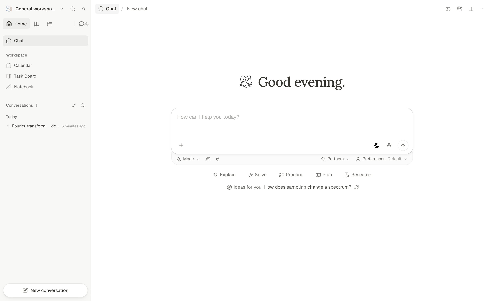
</div>

| क्षेत्र | Scope | इसमें क्या है |
| --- | --- | --- |
| **Home** | Workspace | Chat, Task Board, Calendar, और Learning notebook |
| **Learning** | Workspace | Books, Mastery Path, Immersive Reading, और Practice |
| **Resources** | Workspace | Chat History, Favorites, Learning journal, Question Bank, और Knowledge Center |
| **Partners** | Account | Persistent companions, Partner Groups, resource access, और IM channels |
| **Personalization** | Account | My Agents, Personas, Skills, MCP Services, CLI Apps, Memory, और Settings |

<details>
<summary><b>🏗️ सिस्टम आर्किटेक्चर</b></summary>

<div align="center">
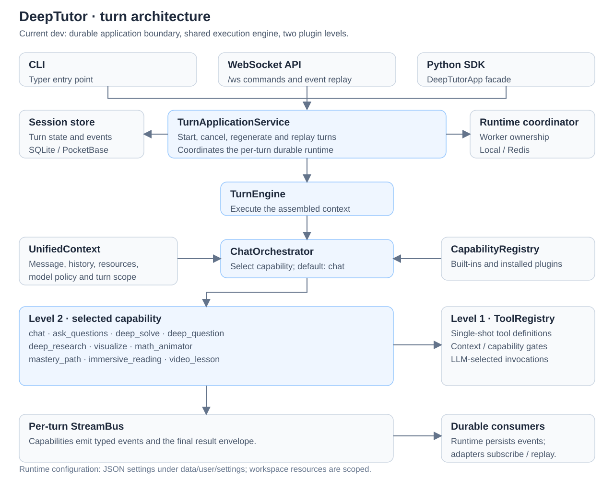
</div>

</details>

<details>
<summary><b>🏠 Home — Conversations, Tasks, Notes, और Calendar</b></summary>

Home दैनिक काम की शुरुआत की जगह है: tutor से बात करें, अगले actions व्यवस्थित करें, और current workspace में अपने notes विकसित करें। Calendar account-wide view देता है, साथ ही study events के लिए source workspace बनाए रखता है।

<details>
<summary><b>💬 Chat — वह Agent Loop जिसे आप वास्तव में उपयोग करते हैं</b></summary>

Chat default capability है और जहां से अधिकांश काम शुरू होता है। एक single thread normally बात कर सकता है, tools call कर सकता है, selected knowledge bases में खुद को ground कर सकता है, attachments पढ़ सकता है, images generate कर सकता है, subagents से consult कर सकता है, notebook records लिख सकता है, और turns के पार same context के साथ जारी रह सकता है।

<div align="center">
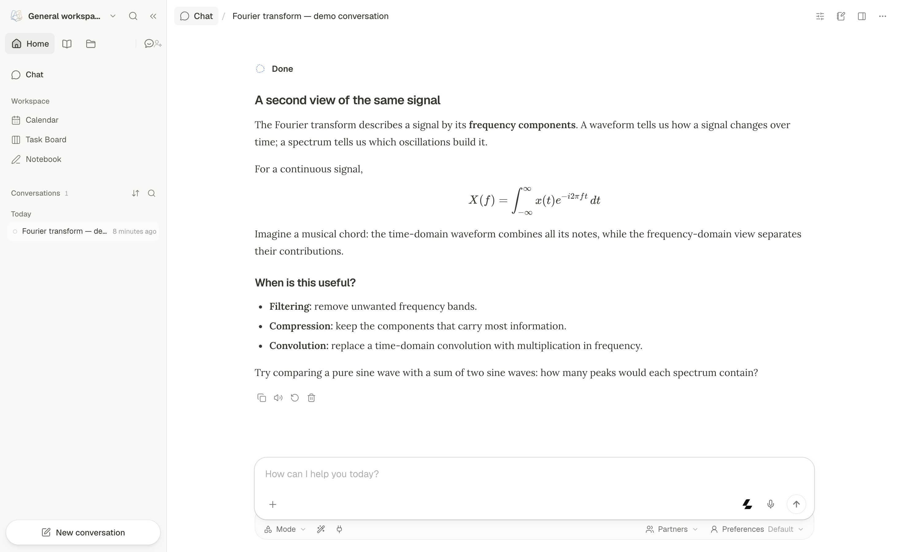
</div>

Tutor जरूरत के अनुसार tools call करता है और स्पष्टता के लिए सवाल पूछते समय रुक सकता है। ऊपर दाईं ओर **Customize page** से दिखने वाले modes और Skills, MCP, Partners, Preferences तथा voice-input controls चुनें। **Starting prompts** में Explain, Solve, Practice, Plan और Research के titles और prompts जोड़ें, बदलें या हटाएं। Save आपके account preferences लागू करता है; Cancel बदलाव छोड़ देता है, और Restore defaults मूल विकल्प वापस लाता है।

<div align="center">
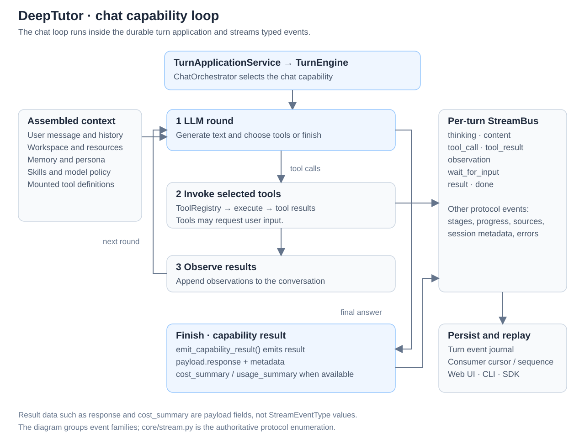
</div>

User-toggleable tools हैं `brainstorm`, `web_search`, `paper_search`, `zotero_search`, `reason`, और `geogebra_analysis` — साथ ही `imagegen` और `videogen` जब आप matching generation model configure करें। Contextual tools जैसे `rag`, `kb_files`, `knowledge_frontier`, `read_source`, `read_memory`, `write_memory`, `read_skill`, `load_tools`, `exec`, `web_fetch`, `ask_user`, `list_favorites`, `save_favorite`, `write_note`, `search_notes`, `question_bank`, `github`, `consult_subagent`, `workspace_list`, `workspace_read`, `workspace_search`, `workspace_present`, और `workspace_export` तब automatically mount होते हैं जब turn के पास सही context हो।

Context दो प्रकार की होती है: **sticky session context** (capability, workspace या course, tools, knowledge bases, persona, model, और Reading / Mastery state) turns के पार persist करती है; **references** (files, chat history, books, reading sections, notebooks, चुनी हुई question-bank entries, imported agents) default रूप से एक turn के लिए `+` menu से आते हैं, या pin करने पर हर turn में। Voice button केवल current message को transcribe करता है।

Full profile में Home से **Chat**, **Ask Questions**, **Quiz**, **Visualize** और **Video Lesson** एक क्लिक में खुलते हैं; cited reports के लिए **Research** और worked reasoning के लिए **Solve**, *More Capabilities* के नीचे रहते हैं। किसी answer में text select करके **Little Tutor** खोलें — एक focused sidebar thread जो source conversation के नीचे nested रहता है। कम से कम तीन messages भेजने पर, जगह होने पर left gutter हर question के लिए एक tick दिखाता है; preview के लिए hover करें, वापस जाने के लिए click करें, या questions के बीच जाने के लिए **Alt/Option + ↑/↓** उपयोग करें।

</details>

<details>
<summary><b>✅ Task Board और Calendar — दैनिक Learning व्यवस्थित करें</b></summary>

**Task Board** पढ़ाई के tasks को To do, In progress और Done में track करता है, notes, drag-and-drop या keyboard से सुलभ move controls, और restore किए जा सकने वाले archive के साथ। Tasks current workspace में रहते हैं और किसी model configuration की जरूरत नहीं है।

**Calendar** personal study sessions, repeating events, और reminders को एक साथ रखता है, Apple Calendar, Google Calendar, Outlook, और Thunderbird के लिए `.ics` export के साथ। Task due dates और reviews जैसे workspace overlays अपने source workspace से जुड़े रहते हैं।

</details>

<details>
<summary><b>✍️ Learning Notebook — पेज, स्रोत और Dito</b></summary>

<div align="center">
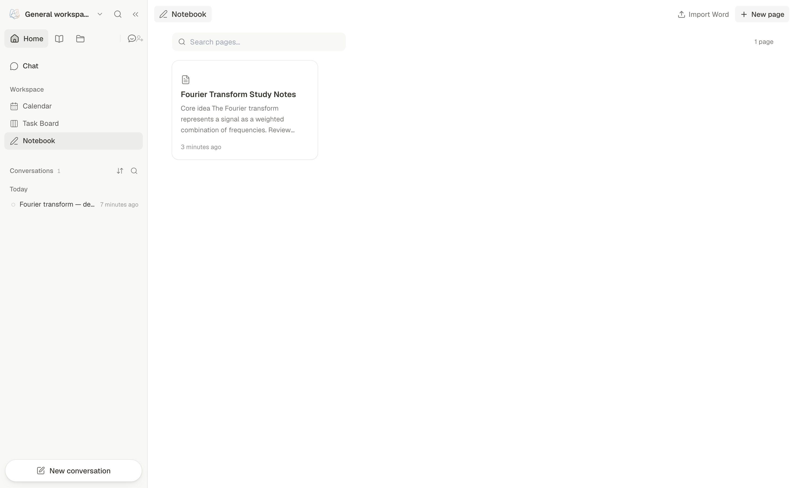
</div>

Learning notebook, जिसे पहले Co-Writer कहा जाता था, active workspace में आपके अपने लेखन को pages, subpages और blocks में व्यवस्थित करता है। Word documents import करें, page tree व्यवस्थित करें और Favorites के original records को प्रमाण के रूप में जोड़ें। Pages पर save status दिखाई देता रहता है और उन्हें Markdown या Word में export किया जा सकता है; Word में interactive content स्थिर हो जाता है।

**Flashcards को Anki में export करें।** Notebook pages में Flash Cards हो सकते हैं। जिन pages में ये हों, page menu खोलें और **Export flashcards (Anki)** चुनें। Notebook review queue से **Export all for Anki** चुनें। Anki में **File → Import** उपयोग करें और downloaded `.txt` file select करें। Cards `DeepTutor::<note title>` नाम के deck में front/back fields, tags, और math सुरक्षित रखते हुए आते हैं। उसी file को दोबारा import करने से duplicate बनने के बजाय existing cards update होते हैं। DeepTutor का अपना review schedule शामिल नहीं होता।

<div align="center">
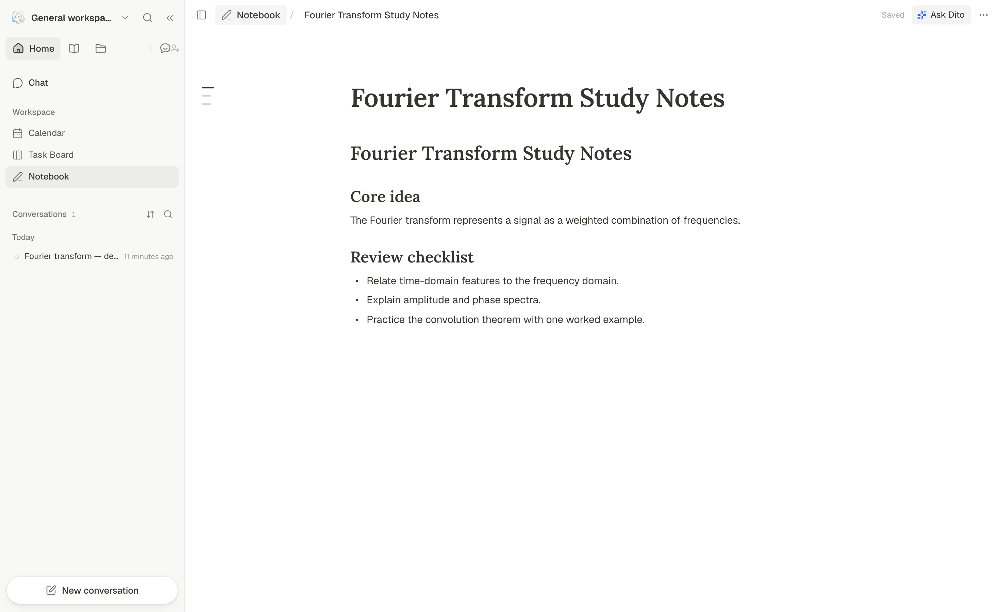
</div>

किसी passage या block पर **Dito** से बातचीत करें: explanation, example, rewrite या practice question मांगें। Conversations संबंधित page और line से जुड़ी रहती हैं। प्रस्तावित बदलाव स्वीकार करने से पहले उनकी समीक्षा करें, या line के नीचे answer जोड़कर काम जारी रखें। Favorites original source records सुरक्षित रखता है; notebook में आप अपनी समझ तैयार करते हैं।

</details>

</details>

<details>
<summary><b>🎓 Learning — Books, Paths, Reading, और Practice</b></summary>

Learning current workspace का study area है। **Learning → New learning** से activity बनाएं, फिर उसकी progress, conversations, और source context सुरक्षित रखते हुए **All learning** से उसे फिर खोलें।

<div align="center">
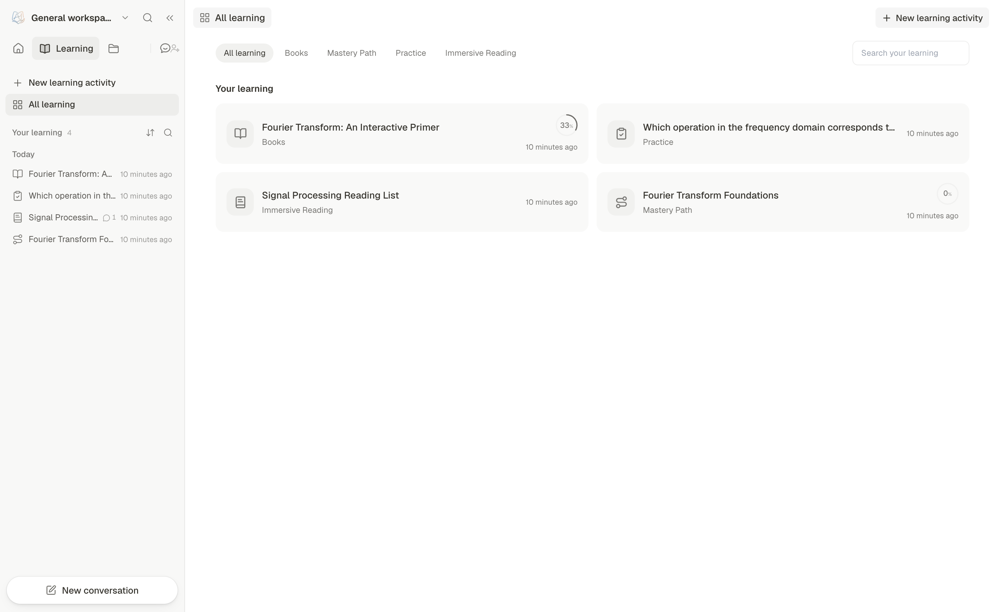
</div>

| Activity | किसलिए उपयोग करें | आपके पास क्या रहता है |
| --- | --- | --- |
| **Book** | Selected sources से structured, interactive book बनाएं | Editable chapters, typed blocks, reading progress, और Page Chat |
| **Mastery Path** | Learning goal को topics और guided study में बांटें | Knowledge-point map, topic conversations, और mastery evidence |
| **Immersive Reading** | Document, web page, video, या audio source के बगल में काम करें | Source-linked conversations, verified citations, highlights, notes, और progress |
| **Practice** | Collected या imported questions की review करें | Answers, mistakes, recall ratings, और अगली review date |

<details>
<summary><b>📖 Book — आपकी सामग्री से जीवंत पुस्तकें</b></summary>

<div align="center">
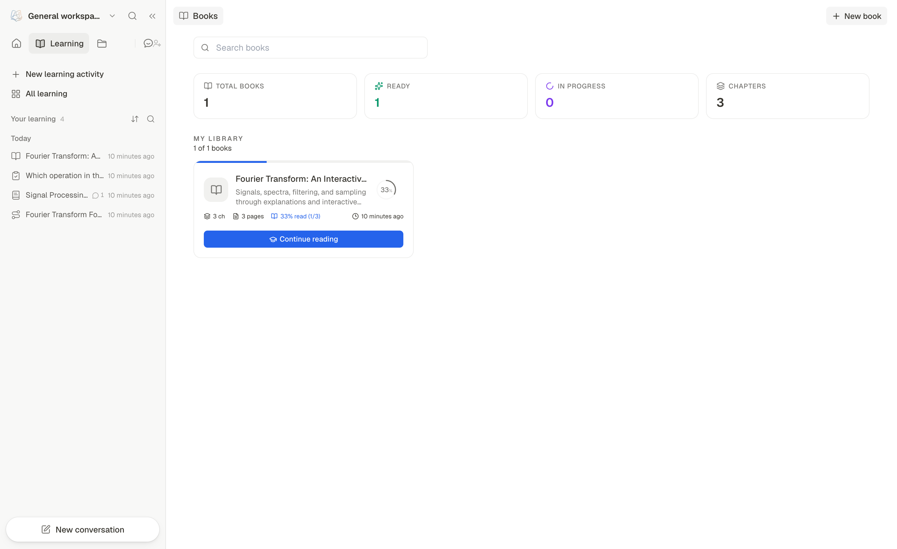
</div>

Book selected sources को एक interactive **living book** में बदलता है — एक static PDF नहीं, बल्कि typed blocks से बना एक reading environment। एक book knowledge bases, Favorites, question banks, या chat history से शुरू हो सकती है; creation flow content generate होने से पहले एक chapter outline propose करता है, इसलिए आप blind one-shot output accept करने की बजाय shape review करते हैं।

<p align="center">
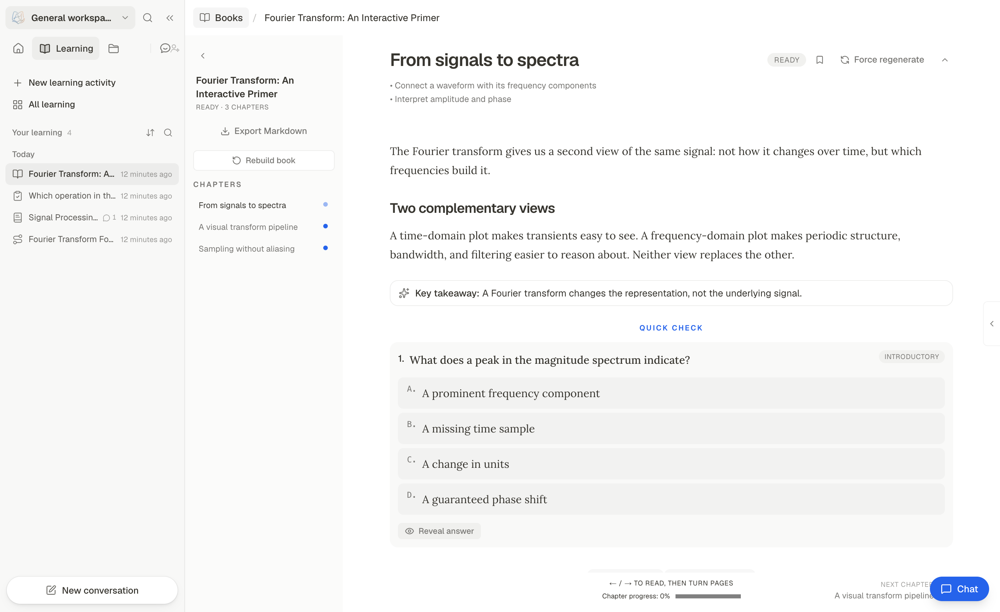
&nbsp;

&nbsp;
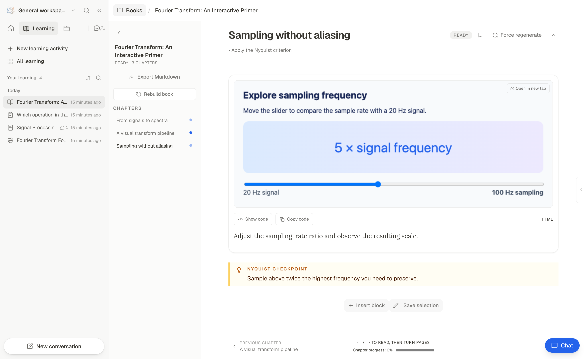
</p>

हर chapter editable typed blocks में compile होता है — text, callouts, quizzes, flash cards, timelines, code, figures, interactive HTML, animations, concept graphs, deep dives, और user notes — और उसका अपना Page Chat होता है। किसी block को insert, move, regenerate, rewrite, या उसका type switch करें; selected passages review की जा सकने वाली learning-capture inbox में जाते हैं। Progress, bookmarks, quiz attempts, captures, और Page Chat हर reader के लिए private रहते हैं, भले admin की book read-only या collaborative editing के लिए share की गई हो; shared deletion admin-only रहता है। कोई भी book Markdown में export हो सकती है, लंबी compiles pause और resume होती हैं, `deeptutor book health` source drift flag करता है, और `deeptutor book refresh-fingerprints` source baseline refresh करता है।

</details>

</details>

<details>
<summary><b>🗂️ Resources — Materials और Saved Learning Records</b></summary>

Resources current workspace की reusable library है। Original material, saved results, और learning records यहां रखें ताकि उन्हें projects मिलाए बिना नई conversations और activities में attach किया जा सके।

<details>
<summary><b>📚 Knowledge Center — कई इंजन वाली RAG लाइब्रेरी</b></summary>

<div align="center">
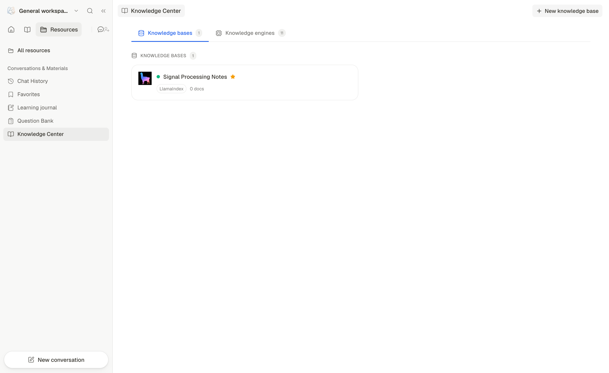
</div>

Knowledge bases RAG के पीछे document collections हैं — वे Chat turns, Learning notebook edits, Book generation, और Partner conversations को ground करते हैं। जो distinctive है वह है **retrieval engines का choice**: **LlamaIndex** (default, hybrid vector + BM25 के साथ optional cross-encoder reranking और exact-flat या HNSW FAISS indexes), **PageIndex** (page-level citations वाला reasoning retrieval, hosted या self-hosted OSS), **GraphRAG** और **LightRAG** (knowledge-graph retrieval), **LightRAG Server** (retrieval एक external LightRAG instance पर offload किया जाता है जिसे आप HTTP पर connect करते हैं), **WeKnora** (आपके self-hosted deployment की knowledge base से retrieval, बिना local index या document copy के), **Tencent IMA** (एक library जिसे आप IMA में curate करते हैं — इसके OpenAPI पर search, browse, और write back किया जाता है), **MarginNote 4** (आपका MN4 study data — documents, excerpts, mind-map cards और उनके बीच के links — जिन्हें app का Add-on push करता है और dedicated tools से navigate किया जाता है), **Kiwix** (बिना local indexing के HTTP पर serve किया गया searchable ZIM archive), या एक linked **Obsidian** vault जिसे tutor in-place पढ़ता और लिखता है। हर KB एक engine से bound होती है।

<div align="center">
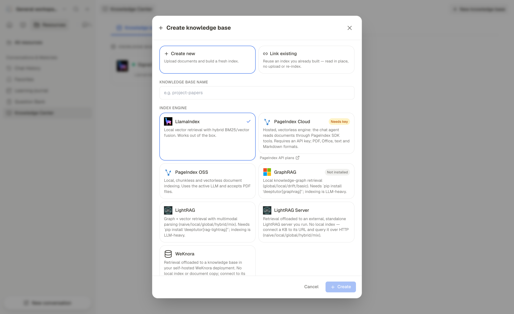
</div>

Existing Obsidian, Hermes, या Markdown library migrate कर रहे हैं? Connected-vault और indexed-copy paths के लिए [Knowledge migration guide](../../docs-for-dev/KNOWLEDGE_MIGRATION.md) देखें।

KB बनाते समय, आप **नया create** कर सकते हैं (documents upload और index करें), **existing link** कर सकते हैं (किसी index को in-place reuse करें), या **Kiwix connect** कर सकते हैं (serve किए गए एक ZIM archive में जरूरत पर search करें)। Creation के समय उसका storage workspace चुनें; existing KB को preview के बाद workspaces के बीच move किया जा सकता है, जबकि assignments और saved references बने रहते हैं। एक KB **GitHub repositories** (repo, branch, glob) या **documentation-site URLs** (सीमित crawl depth और page count, default रूप से हर 24 घंटे में re-sync) को भी track कर सकती है; sync added, changed, और removed content का hash-diff करती है, इसलिए जो documentation आप follow करते हैं वह re-upload किए बिना current बनी रहती है, और **linked folders** sync पर नई या बदली हुई local files pick up करते हैं। Re-indexing एक नई flat `version-N` directory लिखता है और prior ones रखता है, इसलिए एक working index rebuild के दौरान कभी destroy नहीं होता। एक single document को **error**-state base से भी remove किया जा सकता है — पूरी delete-and-rebuild के बिना parse होने में failed हुई file को drop करना। Document parsing — Text-only, MinerU, Docling, Tika, markitdown, PyMuPDF4LLM, या LiteParse — और एक optional image-description model **Settings → Knowledge & documents** में चुने जाते हैं, local model downloads default रूप से off हैं। Docling को **remote** mode में भी एक Docling Serve server के विरुद्ध चलाया जा सकता है (कोई local install या models की जरूरत नहीं), जिसे उसी page पर (`mode=remote`, एक server base URL, और एक optional API key) या `DOCLING_MODE` / `DOCLING_API_BASE_URL` / `DOCLING_API_TOKEN` environment variables के जरिए configure किया जाता है। Tika remote-only है और उस page पर configured Apache Tika server पर point करता है। CLI lifecycle को `list/info/create/connect-kiwix/add/search/eval/eval-diff/set-default/delete`, source add/remove commands, `list-sources`, और `sync` से mirror करता है।

Built-in LightRAG engine `pip install 'deeptutor[rag-lightrag]'` से install होता है। उस extra में supported LightRAG SDK शामिल है लेकिन यह MinerU install नहीं करता। Document Parsing में MinerU को स्वतंत्र रूप से चुनें और structured parsing चाहिए हो तो या तो इसका cloud mode configure करें या इसका current local CLI install करें। MinerU PDF, common raster images, DOCX, PPTX, और XLSX स्वीकार करता है; legacy `magic-pdf` command PDF-only रहता है। Text-only और बाकी parsing engines को MinerU की जरूरत नहीं होती।

Native LightRAG queries और incremental indexing को उस embedding configuration की जरूरत होती है जो published index द्वारा record की गई है, जिसमें model, dimension, और endpoint identity शामिल हैं। अगर यह बदल जाती है, तो original configuration restore करें या current embedding के साथ rebuild करें; जिन indexes में recorded embedding identity नहीं है उन्हें rebuild करना जरूरी है। Knowledge-base detail और index-version views recovery guidance दिखाते हैं, जबकि files viewing और download के लिए उपलब्ध रहती हैं।

**Knowledge base का मूल्यांकन।** कई engines उपलब्ध हों, तो “यहां कौन सबसे अच्छा retrieval करता है?” का जवाब परीक्षण से मिलता है — `deeptutor kb eval` यही करता है। एक QA set लिखें (हर line पर एक JSON object: एक `query` और `gold` passages जो आदर्श retrieval में मिलने चाहिए), फिर `deeptutor kb eval <name> --dataset qa.jsonl --top-k 5 [--mode hybrid] [--save baseline.json]` से KB का मूल्यांकन करें। हर case उसी path से retrieve होता है जो chat turn उपयोग करता है; उसके ranked citations को exact text या lexical overlap से gold passages के साथ match किया जाता है (thresholds `--min-ratio` से बदले जा सकते हैं; semantic equivalence का मूल्यांकन नहीं होता), और run **Recall@k / Precision@k / nDCG@k / MRR / MAP / Hit@k** report करता है। Metrics ranking पर pure functions हैं; कोई model output को judge नहीं करता। हर metric और case के बदलाव देखने के लिए saved reports को `deeptutor kb eval-diff baseline.json candidate.json` से compare करें। Original और rewritten queries की तुलना के लिए `kb eval` में `--rewrite off` या `--rewrite standalone` उपयोग करें; reports में rewrite provenance बनी रहती है। जिन cases की search fail हुई (missing index या गलत credentials), उनका score नहीं होता और उन्हें अलग report किया जाता है, जिससे वे averages को नीचे नहीं खींचते। PageIndex retrieval के लिए reasoning उपयोग करता है और ranked chunks नहीं लौटाता, इसलिए उसे शामिल नहीं किया जाता।

```jsonl
{"query": "Why do transformers scale attention?", "gold": ["Scaling keeps the dot products from growing with the dimension."]}
```

</details>

<details>
<summary><b>🗃️ History, Favorites, Journal, और Question Bank</b></summary>

<div align="center">
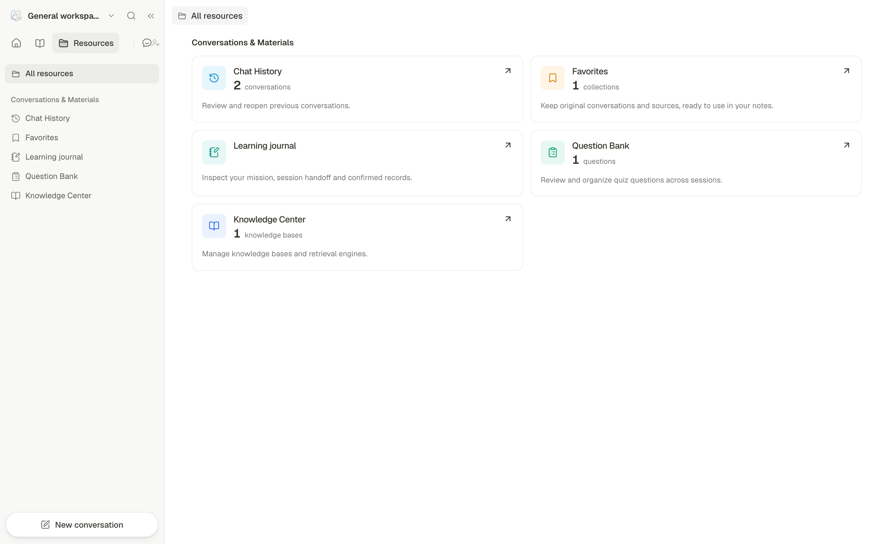
</div>

**Chat History** conversations को उनके original learning context के साथ फिर खोलता है। **Favorites** उपयोगी original conversations और results को movable collections में Markdown export के साथ सुरक्षित रखता है, ताकि उन्हें Learning notebook में जोड़ा जा सके। **Learning journal** current mission, session handoff, और confirmed learning records दर्ज करता है। **Question Bank** questions, answers, explanations, और mistakes व्यवस्थित करता है; कमजोर areas की review और repetition schedule करने के लिए **Learning → Practice** के लिए एक set चुनें।

</details>

</details>

<details>
<summary><b>🤝 Partners — Workspaces के पार Persistent Companions</b></summary>

Partners किसी एक subject workspace के बजाय account से जुड़े होते हैं। हर companion अपनी identity, instructions, model policy, relationships, और channels रखता है, साथ ही private library या किसी existing workspace के resources उपयोग करता है।

<div align="center">
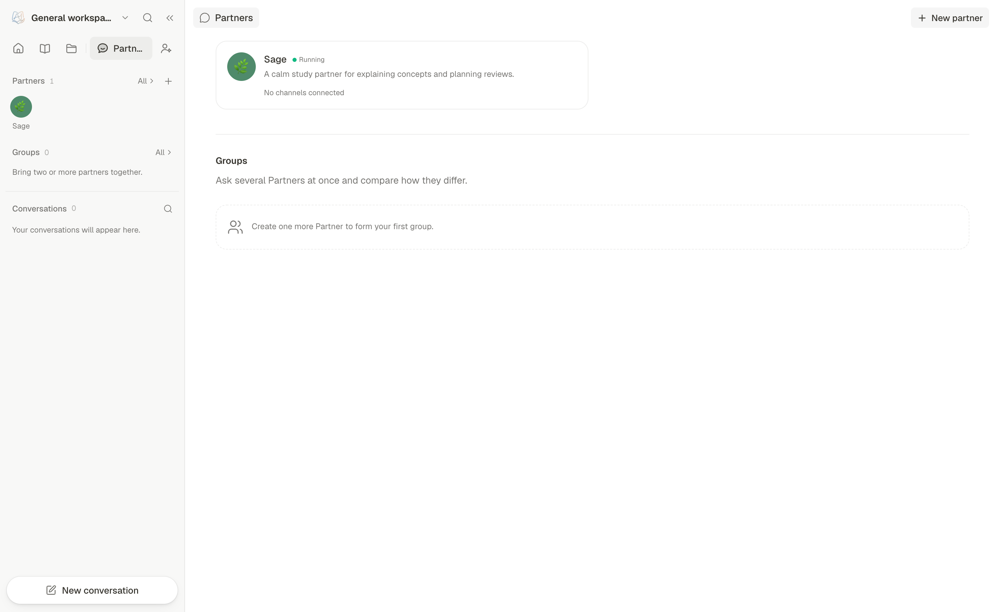
</div>

<details>
<summary><b>Identity, Workspace Resources, Groups, और Channels</b></summary>

हर inbound Web या IM message एक normal `ChatOrchestrator` turn बन जाता है — Partner “एक chat है जिसकी personality और phone number है।” इसका `SOUL.md`, model selection, tool policy, और library बनाने के बाद भी editable रहते हैं। Private Partner workspace assigned knowledge bases, skills, और Favorites collections copy करता है; bound workspace इसके बजाय अपनी current files और resources share करता है। दोनों modes में Soul, conversations, और relationship memory अलग रहते हैं।

<div align="center">

</div>

**Partner Groups** दो या अधिक Partners को distinct seats, selectable discussion और shared-memory modes, तथा durable history के साथ एक shared conversation में लाते हैं। Companion share होने पर भी authenticated users private Partner sessions और relationship memory रखते हैं।

<div align="center">
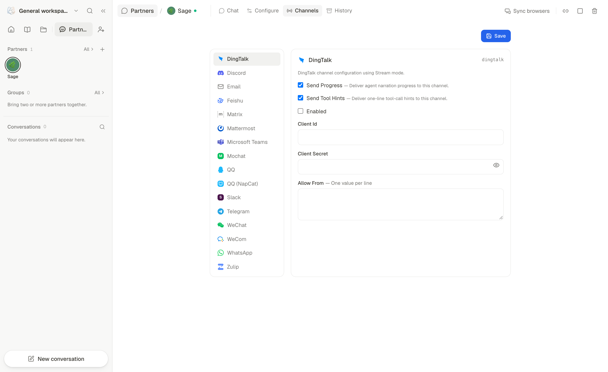
</div>

Schema-driven channels installed extras और credentials के अनुसार companions को Feishu, Telegram, Slack, Discord, DingTalk, QQ/NapCat, WeCom, WhatsApp, Zulip, Mattermost, Matrix, Mochat, और Microsoft Teams से connect करते हैं। Browser-based setup selected channels के लिए QR onboarding support करता है। Partner को **Personalization → My Agents** से भी connect किया जा सकता है और normal Chat turn से consult किया जा सकता है।

</details>

</details>

<details>
<summary><b>🧭 Personalization — Reusable Behavior और Connections</b></summary>

Personalization account के साथ सभी workspaces में चलता है। चुनें कि tutor को कैसा behave करना चाहिए और कौन से agents, skills, services, applications, और memories वह reuse कर सकता है; workspace और conversation selections उस access को और सीमित कर सकते हैं।

<div align="center">
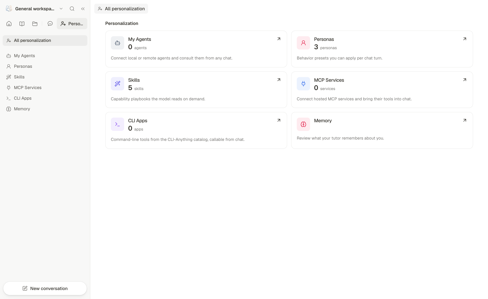
</div>

<details>
<summary><b>🧑‍🚀 My Agents — Live Agents से सलाह लें और History Import करें</b></summary>

<div align="center">
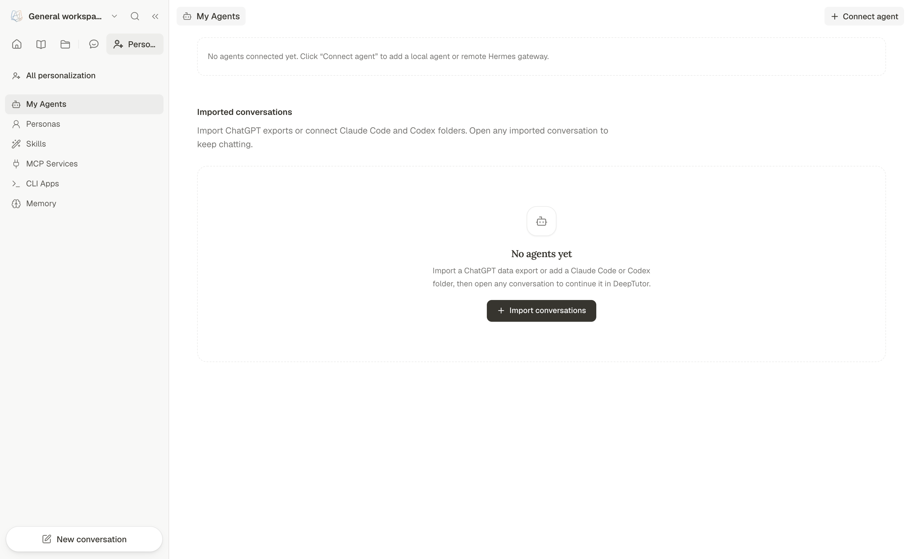
</div>

**Live agent connect करें** — Claude Code, Codex, Grok CLI, Antigravity, Kimi, opencode, MiMo Code, Hermes Agent, OpenClaw, DeepSeek Harness, या Partner — और Chat turn से उससे सलाह लें। DeepTutor selected agent चलाता है और `consult_subagent` के जरिए उसके काम को Activity panel में stream करता है; Agent chip या `@` connection को session से जुड़ा रखता है। Local harnesses अपनी authentication, working directory, और session storage उपयोग करते हैं।

ChatGPT, Claude Code, और Codex से **पिछली conversations import करें**, searchable, resumable references के रूप में। ChatGPT official `conversations.json` export उपयोग करता है; Claude history project या working directory से, और Codex history date से चुनी जाती है। Imported conversation को `+` → My Agents से reference करें, बिना उसे DeepTutor की अपनी voice में बदले।

</details>

<details>
<summary><b>🎭 Personas, Skills, MCP Services, और CLI Apps</b></summary>

**Personas** किसी voice, teaching style, या response policy को reuse करते हैं और Partner की soul को seed भी कर सकते हैं। **Skills** repeatable workflows को `SKILL.md` playbooks के रूप में package करती हैं, जिनमें account-shared और workspace-local libraries होती हैं। **Import from EduHub** community skills browse करता है और security gate के जरिए install करता है (देखें [Ecosystem](#-इकोसिस्टम--eduhub-और-skills-community))।

<div align="center">
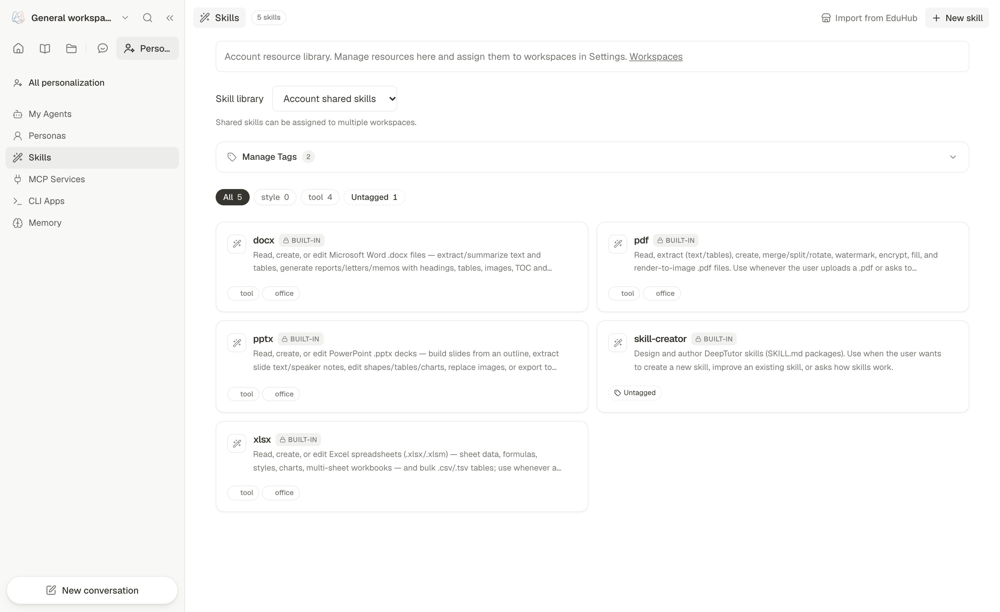
</div>

**MCP Services** external tools को authorize करते हैं, जबकि **CLI Apps** execution sandbox के जरिए [CLI-Anything](https://github.com/HKUDS/CLI-Anything) catalog के installed programs expose करते हैं। Workspace assignments और user grants तय करते हैं कि हर turn कौन से resources उपयोग कर सकता है।

</details>

<details>
<summary><b>🧠 Memory — जांचा जा सकने वाला वैयक्तिकरण</b></summary>

<div align="center">
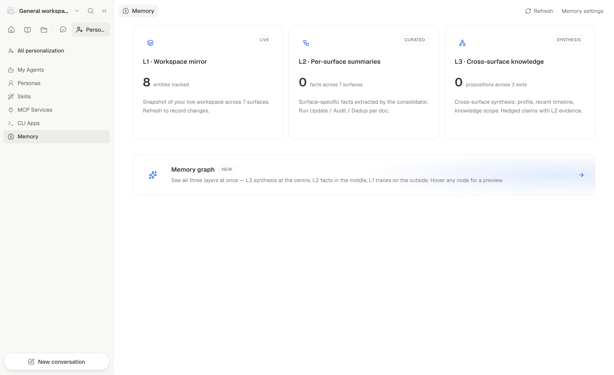
</div>

Memory एक file-backed, three-layer system है जिसे आप पढ़, curate, और audit कर सकते हैं — जानबूझकर एक hidden vector store *नहीं*। **L1** workspace mirror plus एक append-only event trace (`trace/<surface>/<date>.jsonl`) है; **L2** per-surface curated facts (`L2/<surface>.md`) है, जिसमें L1 entities के references होते हैं; **L3** cross-surface synthesis (`L3/<profile|recent|scope|preferences>.md`) है, जो अपनी contributing L2 surfaces record करता है।

<div align="center">
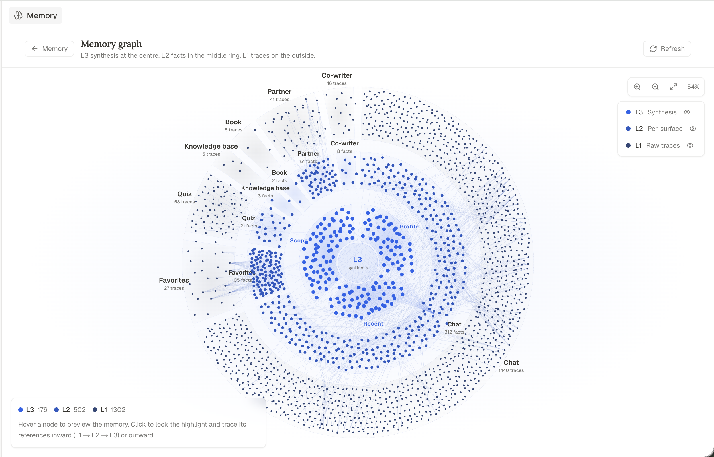
</div>

Memory Graph पूरा pyramid दिखाता है — L3 synthesis centre में, L2 middle ring में, L1 traces outside में — exact L2 → L1 evidence edges और L3 → contributing-surface links के साथ। Memory `chat`, `notebook`, `quiz`, `kb`, `book`, partner, और `cowriter` surfaces पर track किया जाता है; consolidator के Update / Audit / Dedup budgets **Settings → Memory** में tune किए जाते हैं।

</details>

<details>
<summary><b>⚙️ Settings — एक Control Plane</b></summary>

<div align="center">
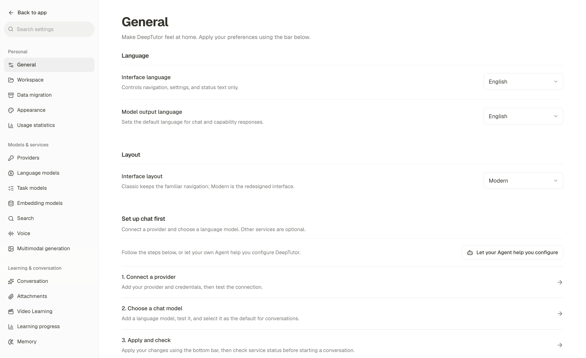
</div>

Settings operational control plane है, जो interface और model output language के लिए **General** पर खुलता है। इसका searchable navigator independent pages से जोड़ता है: **Personal** में Workspaces, Data migration, Appearance और Usage statistics हैं; **Learning & conversation** में starting points, attachments, Video Learning, learner और guardian controls, Learning progress, तथा Memory हैं; **Models & services** में Providers, Language models, Task models, Embedding, Search, Voice और Multimodal generation हैं; **Features & integrations** में tools, capability parameters, Partners & agents और Knowledge & documents हैं। **System** में Network, Runtime status और About हैं; **Archived chats** archived conversations खोजने, restore करने या permanently delete करने देता है। Runtime status में backend health, resident memory और capability blockers, warnings तथा suggestions को grade करने वाला **Readiness** matrix है। Workspaces topic files और learning state अलग रखता है, जबकि Data migration में verified migration और export उपलब्ध हैं। एक **provider** vendor का address और credential रखता है ताकि उसके service models उन्हें reuse कर सकें; model pages saved providers चुनते हैं और model names तथा capabilities configure करते हैं। **Task models** automatic work — conversations को नाम देने और starting points लिखने से लेकर Math Animator और Video Lesson repairs तक — के लिए छोटा, तेज़ model pin करते हैं, और खाली होने पर active default पर resolve होते हैं। Voice में speech synthesis और transcription एक साथ हैं; Multimodal generation में image और video models हैं। Partners & agents local harnesses और remote Hermes gateway configure करता है।

**वियतनामी:** **Settings → General** में **Interface language** के लिए **Tiếng Việt** चुनें और **Apply changes** select करें। **Model output language** स्वतंत्र है: वियतनामी उत्तरों के लिए वहां **Tiếng Việt** चुनें, या वियतनामी interface उपयोग करते हुए कोई दूसरी reply language रखें। उत्तर की गुणवत्ता चुने गए model के वियतनामी support पर निर्भर करती है।

**Xiaomi MiMo वाक् संश्लेषण।** `https://api.xiaomimimo.com/v1` और उसकी API key के साथ Xiaomi MiMo provider जोड़ें, फिर Settings → Voice में `mimo-v2.5-tts` जोड़ें। `mimo_default`, `冰糖` या `苏打` जैसा preset चुनें, `wav` या `pcm16` output उपयोग करें, और apply करने से पहले उसकी आवाज़ सुनकर जांचें। Voice instructions शैली और बोलने की गति नियंत्रित करते हैं। यह adapter केवल preset speech support करता है; voice design और voice cloning के लिए अलग models चाहिए और वे supported नहीं हैं। अगर पुराना MiMo speech model generic OpenAI-compatible adapter से configure किया गया था, तो Xiaomi MiMo provider से उसकी speech entry फिर बनाएं ताकि वह chat-completions protocol उपयोग करे। [आधिकारिक MiMo वाक् संश्लेषण गाइड](https://mimo.mi.com/docs/zh-CN/quick-start/usage-guide/audio/speech-synthesis-v2.5) देखें।

**MiniMax वाक् संश्लेषण** — Settings → Voice में text-to-speech के लिए MiniMax चुनें और `speech-2.8-hd` select करें। MiniMax API key configure करें और स्पष्ट रूप से कोई system voice चुनें या custom voice ID दर्ज करें। Default API base `https://api.minimax.io/v1` है; China region के लिए `https://api.minimaxi.com/v1` उपयोग करें। Read-aloud और voice previews native speech endpoint उपयोग करते हैं, जिसमें MP3, WAV, FLAC या PCM output, sample rate, speed और language controls उपलब्ध हैं। Voice IDs और account availability के लिए [MiniMax speech API](https://platform.minimax.io/docs/api-reference/speech-t2a-http) देखें।


Settings → Learning & conversation के तहत **Video Learning**, Reading के लिए YouTube captions और Invidious access configure करता है। Invidious उपयोग करने के लिए administrator द्वारा managed backend API origin (उदाहरण के लिए `http://127.0.0.1:3000`) और browser से accessible public origin set करें, connection test करें, Invidious select करें, और save करें। Reading के add-material dialog में **Browse Invidious** से videos खोजे जा सकते हैं और connected subscriptions तथा playlists खोली जा सकती हैं। YouTube playback official privacy-enhanced player उपयोग करता है; missing captions visible रहते हैं और tutor के evidence को सीमित करते हैं, लेकिन native playback को नहीं रोकते। Source checkout में default YouTube caption loader के लिए `python scripts/install_extras.py video-learning` चलाएं। Existing Watching links conversation history, compatible transcripts, notes और progress को बनाए रखते हुए Reading में migrate होते हैं; नए timestamp notes Reading annotations होते हैं। Bilibili अपनी playback और caption प्रक्रिया उपयोग करता है।

<div align="center">
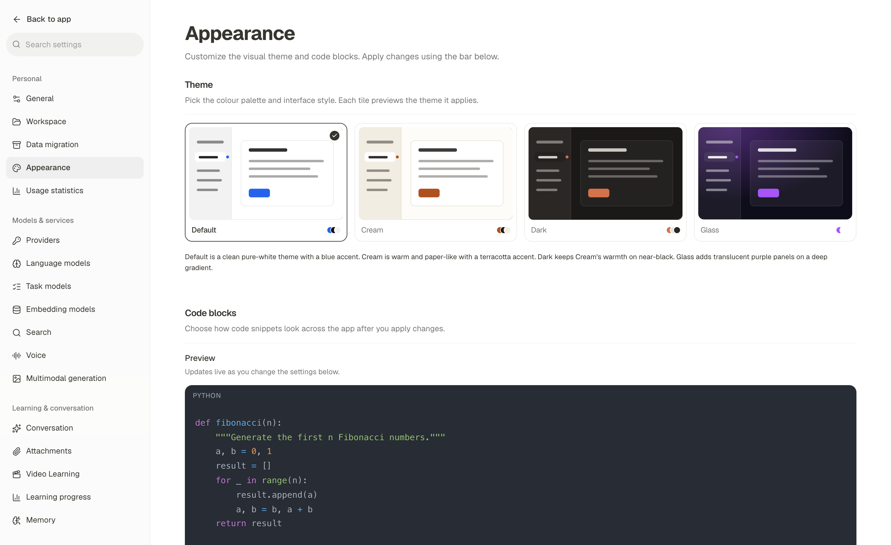
</div>

अधिकांश sections एक draft-and-apply flow उपयोग करते हैं, इसलिए आप provider को commit करने से पहले test कर सकते हैं। आप बस Chat में भी पूछ सकते हैं: assistant current configuration पढ़ता है, एक change apply करता है, और बताता है कि उसे restart या re-index चाहिए या नहीं — एक नए model को commit करने से पहले probe करते हुए, इसलिए यह खुद को किसी unreachable चीज़ पर switch नहीं कर सकता। API keys कभी model से नहीं गुजरतीं, जो इसकी बजाय आपके लिए matching form खोल देता है। चार themes box में आते हैं — Default, Cream, Dark, और Glass। Project-root `.env` files जानबूझकर ignored हैं; runtime configuration `data/user/settings/*.json` के नीचे रहती है जब तक कि `DEEPTUTOR_HOME` या `deeptutor start --home` app को कहीं और point न करे।

**OpenAI Codex OAuth (experimental).** Settings → Providers के तहत **OpenAI Codex** जोड़ने पर एक browser sign-in खुलता है जो आपके अपने ChatGPT plan के विरुद्ध चलता है, इसलिए किसी `OPENAI_API_KEY` की जरूरत नहीं। Tokens केवल `data/system/user-secrets/<owner>/private/openai-codex/` में रहते हैं — multi-container Compose deployment में, उस हर tree के बाहर जहां exec sandbox पहुंच सकता है — और DeepTutor कभी आपकी `~/.codex` CLI login को न तो पढ़ता है न ही modify करता है। Model list उस account के live catalog से आती है; sign in करना profile को publish करता है लेकिन यह active model तभी बनता है जब अभी तक कोई LLM configure न हो। क्योंकि एक token एक व्यक्ति के plan को authorize करता है, profile user grants के जरिए shareable नहीं है — हर account खुद के लिए sign in करता है, सामान्य users भी शामिल: उनका sign-in card Providers के तहत रहता है, और resulting models, catalog, और sign-out उस account के लिए private रहते हैं।

Sign-in और **Refresh models** पर, DeepTutor official npm registry से latest stable `@openai/codex` version पढ़ता है और इसे catalog request के `client_version` के रूप में उपयोग करता है। यह केवल metadata है: यह Codex CLI को install, download, या upgrade नहीं करता, और npm request में कोई OAuth credentials नहीं जाते। Discovery की तीन-second deadline और 64 KiB response limit होती है। अगर यह fail हो जाए, तो DeepTutor उस account के लिए last successful version उपयोग करता है, या कुछ भी cached न होने पर अपना built-in fallback। केवल एक successfully parsed live catalog ही नया version save करता है; validators versions या credential generations के पार कभी reuse नहीं होते। एक version rejection या incompatible catalog structure previous version के साथ एक retry allow करता है; authentication, rate-limit, और TLS failures को version problems के रूप में retry नहीं किया जाता। एक failed manual refresh error report करता है, बजाय किसी old cached catalog को refreshed के रूप में present करने के।

Successful version history same-account token renewal और catalog authentication errors के पार बची रहती है, बिना invalidated model data या ETags को फिर से usable बनाए। Sign out करने से उस account का local cache clear हो जाता है, जिसमें version history भी शामिल है। सामान्य status reads और inference npm को query नहीं करते। नई catalog entries आपके पहले से selected model को replace नहीं करती हैं या learning sessions restart नहीं करती हैं; catalog में दिखना पूरी inference-protocol compatibility स्थापित नहीं करता। कोई background version updater या user version setting नहीं है।

Default local Docker और Podman deployments separate loopback networks उपयोग करते हैं और sign-in के दौरान एक temporary bridge की जरूरत होती है। Docker, Compose, Podman, और teardown के exact commands के लिए [temporary local Codex OAuth bridge guide](../../docs-for-dev/CONTAINERIZATION.md#temporary-local-codex-oauth-bridge) follow करें।

Remote deployment में, browser का `localhost` और server का `localhost` अलग machines हैं, इसलिए सिर्फ एक ordinary reverse proxy browser के localhost callback को server तक नहीं पहुंचा सकता। Callback bridge के रूप में SSH tunnel उपयोग करें। Tunnel पहले से published Web port तक पहुंचता है; Next.js केवल exact callback path को public callback broker पर rewrite करता है, और broker original OAuth operation पर route करने से पहले `state` validate करता है। Callback listener backend loopback पर ही रहता है, ports `1455` और `1457` publish नहीं होते, और यह path default Docker bridge network को support करता है।

```bash
ssh -N -L 1455:127.0.0.1:3782 <ssh-user>@<server-host>
```

अगर DeepTutor fallback callback port `1457` report करता है, तो उपयोग करें:

```bash
ssh -N -L 1457:127.0.0.1:3782 <ssh-user>@<server-host>
```

केवल वही एक command run करें जो actual callback port से मेल खाता हो; कभी दोनों run न करें। `3782` केवल example Web port है: यह configured frontend/container port है जो `callback_forward_port` के रूप में report होता है। यह value गारंटी नहीं देती कि वही port SSH host के `127.0.0.1` पर listen कर रहा है। अगर Docker या Podman कोई अलग host port publish करता है, या कोई reverse proxy किसी अलग port पर listen करता है, तो केवल right-hand target port (ऊपर `3782`) को उस Web port से replace करें जो actually SSH host के `127.0.0.1` पर listen कर रहा है; left-hand callback port को `1455` या `1457` ही रखें। `<server-host>` वह SSH host है जिसका loopback उस listening port को own करता है। अगर browser URL किसी reverse proxy या load balancer का नाम लेता है, तो उसे सही SSH frontend host से replace करें।

CLI tunnel command print करता है और फिर तुरंत browser खोलने की कोशिश करता है। Remote deployment पर, authorization page को complete किए बिना खुला रखें, दूसरे terminal में printed tunnel establish करें, और तभी authorization जारी रखें।

Remote-topology detection की एक localhost boundary है। अगर Web खुद एक SSH या IDE localhost forward के जरिए reach होता है, तो browser यह नहीं बता सकता कि server remote है। Current Web operation के लिए, इसका authorization page अधूरा छोड़ें, callback port `1455` या `1457` identify करने के लिए उस operation के authorize URL में `redirect_uri` पढ़ें, और उस local port से actual Web port तक दूसरा tunnel बनाएं। वैकल्पिक रूप से, उस Web operation को cancel करें और CLI से एक नया शुरू करें; CLI output नए operation से belong करता है और इसे existing Web operation के लिए उपयोग नहीं किया जाना चाहिए। Quota errors और catalog failures जैसे हैं वैसे ही report होते हैं और कभी किसी paid provider पर fall back नहीं करते। यह compatibility path experimental है: upstream interface बदल सकता है।

</details>

</details>

### 🛠️ Administration और Shared Deployments

ऊपर दिए पाँच areas learner-facing workspace बताते हैं। निम्न deployment controls उन administrators के लिए हैं जो कई users के लिए DeepTutor host करते हैं।

<details>
<summary><b>👥 Multi-User — Shared Deployments</b> · optional auth, isolated per-user workspaces</summary>

Authentication **default रूप से बंद** है — DeepTutor single-user चलता है। इसे on करें और एक `data/` tree एक admin workspace, isolated per-user workspaces, और partner workspaces को side by side host करती है:

```text
data/
├── user/                    # Admin workspace + global settings
├── users/<uid>/             # Per-user scope: chat history, memory, notebooks, KBs
├── partners/<id>/workspace/ # Partner (synthetic-user) scope
├── cli-apps/                # Installed CLI apps, mounted read-only into the sandbox
└── system/                  # auth · grants · audit · user-secrets/<owner> (OAuth tokens)
```

**पहला registered user admin बनता है** और model catalogs, provider credentials, shared knowledge bases, skills, canonical shared books, और per-user grants own करता है। Admin द्वारा बनाए गए local users Standard, Learner, या Custom चुनते हैं। Learner learning capabilities और material policy को lock करता है, adaptive profile जोड़ता है, और expiry तथा daily limits वाले revocable device credentials support करता है; authorized guardians reports देख सकते हैं, materials approve कर सकते हैं, और credentials reset कर सकते हैं। अन्य users को raw API keys दिए बिना isolated workspaces के साथ scoped models, KBs, skills, partners, और shared-book access मिलता है। अगर `auth.json` में पहले से `username` + `password_hash` है, तो वही account *admin है*: `/register` बंद रहता है और `/admin/users` से बनाए गए accounts हमेशा `role=user` रहते हैं, जब तक आप उन्हें promote न करें।

**Enable करें:** `data/user/settings/auth.json` में auth on करें, `deeptutor start` restart करें, `/register` पर पहला admin register करें, फिर `/admin/users` से users add करें और grants के जरिए models, KBs, skills, partners, tool/MCP/CLI-app policy, और code-execution access assign करें; हर user के **Book access** panel में shared books configure करें।

Split private/public origins के लिए, `auth.private_login_hosts` (या `AUTH_PRIVATE_LOGIN_HOSTS`) को उन private frontend hosts पर set करें जो password sign-in और registration दिखा सकते हैं। Frontend incoming HTTP `Host` को backend तक अपने frontend-host assertion के रूप में forward करता है। अपने reverse proxy के through browser का `Host` preserve करें, और public ingress को किसी private host का नाम लेने वाले requests reject करने दें; कोई raw Next.js port expose न करें जो arbitrary `Host` values accept करता हो। HTTP `Host` को एक direct client द्वारा forge किया जा सकता है, इसलिए private-host authorization उस ingress boundary पर depend करता है। Backend default रूप से केवल loopback से frontend-host assertions accept करता है। अगर Web frontend किसी दूसरे container या host से connect होता है, तो backend process पर `AUTH_TRUSTED_FRONTEND_PROXY_IPS` को उस frontend proxy के exact IP address पर set करें (एक से अधिक होने पर comma-separated)। यह defaults को replace करता है; अगर local frontend connections भी चाहिए, तो `127.0.0.1,::1` शामिल करें। Backend API को frontend proxy तक ही private रखें और इस list में general client networks शामिल न करें। `private_login_hosts` non-empty होने पर, private origin पर एक authenticated user **Profile → Public device sign-in** खोल सकता है और किसी HTTPS public origin के लिए एक short-lived, host-bound pairing link बना सकता है। Public `/handoff` page one-time code को एक POST body में equally short JWE ticket से exchange करता है, ticket को एक बार consume करता है, और normal HttpOnly session cookie प्राप्त करता है।

> PocketBase single-user integration रहता है — multi-user deployments के लिए `integrations.pocketbase_url` blank रखें जब तक आपने external user store wire up नहीं किया हो।

</details>

## ⌨️ DeepTutor CLI — एजेंट-नेटिव इंटरफेस

एक `deeptutor` binary, दो तरीके से: terminal में रहने वालों के लिए interactive **REPL**, और DeepTutor को tool के रूप में drive करने वाले दूसरे agents के लिए structured **JSON**। दोनों तरफ same capabilities, tools, और knowledge bases।

<details>
<summary><b>खुद चलाएं</b></summary>

`deeptutor chat` एक interactive REPL खोलता है और `--capability` से mode चुनता है; `deeptutor run <capability> "<message>"` उस capability को अपना पहला positional argument लेता है और एक turn के बाद exit करता है। दोनों `--tool`, `--kb`, `--config` और registered workspace चुनने के लिए `--workspace` accept करते हैं।

```bash
deeptutor chat                                              # interactive REPL
deeptutor chat --capability deep_solve --kb my-kb
deeptutor run chat "Explain the Fourier transform" --kb textbook
deeptutor run chat "Find recent work beyond this material" --kb textbook
deeptutor run deep_research "Survey 2026 papers on RAG" \
  --config mode=report --config depth=standard
```

`--kb` automatic RAG और Knowledge Frontier tools को context देता है; Frontier को knowledge और research दोनों modules चाहिए। `--tool` से user-toggleable tools चुने जाते हैं। Enabled modules KB, session, partner, skill, notebook, memory और config commands भी उपलब्ध कराते हैं।

</details>

<details>
<summary><b>किसी एजेंट को चलाने दें</b></summary>

DeepTutor *दूसरे agent द्वारा operated* होने के लिए built है। किसी भी `run` में `--format json` add करें और हर turn **NDJSON — एक event per line** stream करता है (`content`, `tool_call`, `tool_result`, `done`, …), हर line `session_id` के साथ tagged। Runs headless-safe हैं: बिना TTY के `ask_user` pause automatically empty reply से resolve होता है बजाय hang करने के।

```bash
# One shot, machine-readable
deeptutor run deep_solve "Find d/dx[sin(x^2)]" --tool reason --format json

# Chain turns in one stateful session — capture the id, reuse it
SID=$(deeptutor run deep_research "Survey 2026 papers on RAG" \
  --config mode=report --config depth=standard --format json \
  | jq -r 'select(.type=="done").session_id')
deeptutor run deep_question "Quiz me on that survey" --session "$SID" --format json
```

Repo एक root [`SKILL.md`](../../SKILL.md) ship करता है — CLI के लिए एक संक्षिप्त handover doc। अपने agent से इसे स्पष्ट रूप से पढ़ने को कहें; इसकी [Agent Setup guide](../../docs-for-dev/AGENT_SETUP.md) में installation और configuration दिए गए हैं। आप `deeptutor run` को LangChain / AutoGen loop में एक tool के रूप में भी wrap कर सकते हैं। पूरे recipes: [Agent Handoff](https://deeptutor.info/docs/cli/agent-handoff/)।

</details>

<details>
<summary><b>Manim animations के लिए opt-in visual review</b></summary>

Rendered frames में overlap, readability, और framing जांचने के लिए `enable_visual_review=true` set करें,
फिर detected issues को existing code repair loop में feed करें:

```bash
deeptutor run math_animator "Animate a sine wave" --config enable_visual_review=true
deeptutor run visualize "Animate a sine wave" \
  --config render_mode=manim_video --config enable_visual_review=true
```

यह option default रूप से `false` है। यह `math_animator` के लिए `output_mode=image` और
`visualize` के लिए `render_mode=manim_image` के साथ भी काम करता है। General `auto` loop
सहित अन्य visualizers इसे ignore करते हैं। Manim की optional dependencies फिर भी जरूरी हैं।

SDK turns के लिए, `DeepTutorApp.start_turn()` को भेजे गए `TurnRequest` में
`config={"enable_visual_review": True}` pass करें। API clients JSON `true` के साथ वही
`config` object उपयोग करते हैं। Book animation blocks के लिए, animation `Block` पर
`params={"enable_visual_review": True}` set करें।

Review में vision model calls जुड़ते हैं और repair calls तथा re-renders भी जुड़ सकते हैं,
जिससे cost और latency बढ़ती है। यह चार retries की existing limit उपयोग करता है, जिसमें 120-second
review timeout और 180-second repair timeout है। अगर कोई frames उपलब्ध नहीं हैं या
configured review model images inspect नहीं कर सकता, तो summary के साथ review skip हो जाता है।
सभी retries के बाद unsuccessful review best available render और उसका failed review result
लौटाता है; review timeout existing render error/retry path का पालन करता है।
Capability results `render.visual_review` expose करते हैं; book blocks वही review data
`metadata.visual_review` में रखते हैं (review न चलने पर `null`)।

</details>

<details>
<summary><b>कमांड संदर्भ</b></summary>

इस table में full installation और optional add-ons शामिल हैं; commands और capabilities के लिए उनके modules enabled होने चाहिए। Core में `chat` और `ask_questions` उपलब्ध हैं।

| कमांड | विवरण |
|:---|:---|
| `deeptutor init [--non-interactive] [--home PATH]` | Setup wizard चलाएं, या बिना prompts के missing defaults बनाएं |
| `deeptutor doctor [--online]` | Check करें कि runtime session शुरू करने के लिए ready है या नहीं; `--online` configured model provider को भी probe करता है, `--format json` report print करता है |
| `deeptutor start [--home PATH] [--dev] [--detach] [--no-browser]` | Backend + frontend को एक साथ launch करें; वैकल्पिक रूप से detach करें या browser खुलना रोकें |
| `deeptutor stop [--home PATH]` | `--detach` से शुरू किए launcher को stop करें |
| `deeptutor serve [--port PORT]` | केवल FastAPI backend start करें |
| `deeptutor module list/install/uninstall/enable/disable` | Modules देखें और DeepTutor को रोककर उन्हें बदलें; source checkouts में enable/disable उपलब्ध हैं |
| `deeptutor workspace show/set/reset` | Per-user Content Workspace inspect, select, या restore करें |
| `deeptutor run <capability> <message>` | एक single capability turn run करें (`chat`, `ask_questions`, `deep_solve`, `deep_question`, `deep_research`, `visualize`, `math_animator`, `video_lesson`, `mastery_path`, `immersive_reading`, `audio_overview`); NDJSON output के लिए `--format json` add करें |
| `deeptutor chat` | Capability, tool, KB, notebook, और history controls के साथ interactive REPL |
| `deeptutor partner list/create/start/stop` | IM-connected partners manage करें |
| `deeptutor kb list/info/create/connect-kiwix/add/search/eval/eval-diff/set-default/delete/list-sources/sync` | Knowledge bases manage करें, Kiwix archives connect करें, retrieval runs का मूल्यांकन और तुलना करें, और registered GitHub/web sources sync करें (source add/remove commands के साथ) |
| `deeptutor skill search/install/list/remove/login/logout/publish/update` | Skills manage करें, hubs से install करें, और अपनी खुद publish करें (default `eduhub:<slug>`, Ecosystem देखें) |
| `deeptutor memory show/clear` | L2/L3 memory docs inspect करें या L1/all memory clear करें |
| `deeptutor session list/show/open/rename/delete` | Shared sessions manage करें |
| `deeptutor notebook list/create/show/add-md/replace-md/remove-record` | Markdown files से notebooks manage करें |
| `deeptutor book list/health/refresh-fingerprints` | Books inspect करें और source fingerprints refresh करें |
| `deeptutor plugin list/info/state/search/show/install/approve/enable/disable/rollback/uninstall` | Tools और capabilities inspect करें; reviewed plugin packages और उनकी permission approvals manage करें |
| `deeptutor config show [--home PATH]` | Credentials छिपाकर resolved runtime configuration दिखाएं |
| `deeptutor config providers` | Supported setup providers और defaults को JSON के रूप में list करें |
| `deeptutor config apply FILE [--check] [--home PATH]` | बिना prompts के setup JSON apply करें, या settings लिखे बिना उसे validate करें |
| `deeptutor provider login <provider>` | Provider auth (`openai-codex` OAuth login; `github-copilot` GitHub device login; `codebuddy` CodeBuddy SDK auth validate करता है और ज़रूरत पड़ने पर login शुरू करता है) |

GitHub Copilot credentials signed-in DeepTutor owner के होते हैं और केवल
`<runtime-home>/data/system/user-secrets/<owner-id>/private/github-copilot/credentials.v1.json`
में sandbox workspaces के बाहर रहते हैं। CLI/admin partners administrator के credentials उपयोग करते हैं;
अन्य users अलग से sign in करते हैं, और Copilot profiles model grants के जरिए share नहीं की जा सकतीं।
External nanobot/Copilot token files कभी import नहीं की जातीं: upgrade के बाद
`deeptutor provider login github-copilot` फिर से चलाएं।

Login वर्तमान में discovered model के साथ inference validate करता है; `init` selected
model validate करता है और failure पर draft configuration save किए बिना रुक जाता है। केवल सफल GitHub
authentication से Copilot model access की पुष्टि नहीं होती (validation fail होने पर saved login बना रहता है)।
Runtime requests token exchange से मिले API endpoint का पालन करती हैं, refreshes के दौरान भी,
और हर model के Responses/Chat Completions endpoint metadata का सम्मान करती हैं।

Copilot-specific Responses compatibility stored history को rewrite किए बिना dispatch के समय apply की जाती है।

</details>

<details>
<summary><b>केवल CLI का वितरण</b></summary>

Core wheel में CLI और SDK मिलते हैं; `deeptutor-cli` एक compatibility metapackage है। Source सभी checked-in modules उपलब्ध कराता है, इसलिए CLI उपयोग के लिए उनकी Python dependencies install करें और frontend setup छोड़ दें:

```bash
python -m pip install -r requirements/full.txt
python -m pip install -e . --no-deps
```

Minimal installation के लिए core wheel उपयोग करें। Optional distributions tools, capabilities, API routes, background services और navigation उपलब्ध कराते हैं। Modules एक Python environment साझा करते हैं और उनका version core से मेल खाना चाहिए। `deeptutor[full]` installation के समय सामान्य app modules चुनता है; बाद में अलग-अलग features हटाए जा सकते हैं।

DeepTutor रोकें (उसके terminal में `Ctrl+C`), फिर वही Python environment और `DEEPTUTOR_HOME` उपयोग करें:

```bash
deeptutor module list                       # installed / enabled / ready
deeptutor module disable research           # hide and deactivate; keep code
deeptutor module enable research            # restore it and required modules

# Package installations only; source checkouts use enable / disable:
deeptutor module install solve              # install the matching module and dependencies
deeptutor module uninstall solve --dry-run  # inspect the plan and dependency blockers
deeptutor module uninstall solve            # remove only this module's distribution
deeptutor chat                              # restart the CLI; use start for an installed Web app
```

उदाहरण: `solve`, `research`, `questions`, `knowledge`, `parsing`, `reading`, `mastery`, `books`, `memory`, `notebook` और `partners`। किसी module पर निर्भर modules उसके removal को रोकते हैं; module command से core नहीं हटाया जा सकता। Disable या uninstall करने पर settings, conversations, knowledge bases और generated files सुरक्षित रहते हैं। Shared third-party dependencies भी बनी रहती हैं।

**Browser में:** **Settings → Runtime status → Modules** पर module status और संबंधित terminal commands दिखते हैं। Package बदलने के लिए environment रुका होना चाहिए और बदलाव CLI में किए जाते हैं। **Chat → Customize page** और **Learning → New learning activity → Customize page** आपके निजी page choices तुरंत बदलते हैं; कोई entry छिपाने से उसका module uninstall नहीं होता और न access वापस लिया जाता है।

1.7.0 package family में core और feature wheels के versions एक जैसे होते हैं। Local wheel installation के लिए `module install` में `--wheelhouse /path/to/wheels` दें। Wheels बनाने और deployment की जानकारी के लिए [module installation और source development](../../docs-for-dev/MODULES.md) देखें।

</details>

## 🧩 इकोसिस्टम — EduHub और Skills Community

DeepTutor skills open **Agent-Skills** format उपयोग करती हैं — एक `SKILL.md` playbook (YAML frontmatter + Markdown) और optional reference files के साथ एक folder। इसमें DeepTutor-specific कुछ नहीं है, इसलिए format बोलने वाली कोई भी registry आपकी library के लिए एक source बन जाती है। DeepTutor **[EduHub](https://eduhub.deeptutor.info/)** के साथ ship होता है — हमारी अपनी education-focused skill registry — default hub के रूप में wired in।

<details>
<summary><b>EduHub — DeepTutor का स्किल इकोसिस्टम</b></summary>

[**EduHub**](https://eduhub.deeptutor.info/) वह community hub है जिसे DeepTutor ने teaching-oriented agent skills share करने के लिए launch किया — Socratic tutors, flashcard builders, essay feedback, exam blueprints, concept explainers, और बहुत कुछ। यह DeepTutor में built in है, इसलिए configure करने की कोई जरूरत नहीं: एक bare slug या `eduhub:` prefix इसे resolve करता है।

**ढूंढें और install करें** — browser में, catalog browse करने और directly आपकी library में skill download करने के लिए **Personalization → Skills → Import from EduHub** खोलें। Terminal से:

```bash
deeptutor skill search "socratic tutor"               # search EduHub (the default hub)
deeptutor skill install socratic-tutor                # fetch → verify → register
deeptutor skill install eduhub:socratic-tutor@1.2.0   # pin a hub and a version
deeptutor skill list                                  # local skills with their hub provenance
```

**अपनी खुद publish करें** — एक `SKILL.md` package करें और community के साथ share करें:

```bash
deeptutor skill login                                 # browser sign-in to EduHub
deeptutor skill publish ./my-skill                    # interactive: pick a track + tags, then upload
deeptutor skill update                                # roll back or release a new version
```

EduHub एक standalone, ClawHub-compatible registry भी है, इसलिए DeepTutor नहीं होने वाले agents (Claude Code, Codex, …) इसे `eduhub` CLI के जरिए directly use कर सकते हैं — `npx eduhub install socratic-tutor`।

</details>

<details>
<summary><b>इम्पोर्ट सुरक्षा जांच</b></summary>

Source चाहे जो भी हो, हर import आपके workspace को touch करने से पहले **same safety gate** से गुजरता है:

- registry का **security verdict** पहले check होता है — flagged packages refuse किए जाते हैं जब तक आप `--allow-unverified` pass नहीं करते;
- archives path-traversal, entry-count, size, compression-ratio, suffix, और symlink checks के साथ defensively extract होते हैं; executable bits strip हो जाते हैं, जबकि extensionless files allowed रहती हैं;
- frontmatter DeepTutor के schema में normalize होता है और `always:` **stripped** होता है, इसलिए एक downloaded skill खुद को हर system prompt में force नहीं कर सकती;
- provenance — hub, version, verdict, और install time — audits और updates के लिए `.hub-lock.json` में लिखा जाता है।

Multi-user deployments में, browser imports authenticated caller की skill layer में आते हैं, जबकि CLI और admin-console installs owner/admin workspace को target करते हैं; admin skills grant होने तक सामान्य users से hidden और read-only रहती हैं।

</details>

<details>
<summary><b>ClawHub के साथ भी संगत</b></summary>

क्योंकि DeepTutor open Agent-Skills format बोलता है, **[ClawHub](https://clawhub.ai/)** भी एक first-class source है — यह EduHub के साथ built in है। इसे hub prefix से चुनें:

```bash
deeptutor skill search "git release notes" --hub clawhub
deeptutor skill install clawhub:git-release-notes@1.0.1
deeptutor skill install clawhub:udiedrichsen/stock-analysis
```

जब कई publishers same slug share करते हैं, तो search हर publisher को और एक fully scoped install ref (`clawhub:<ownerHandle>/<slug>`) दिखाता है।

`data/user/settings/skill_hubs.json` में और registries add करें: एक `type: "clawhub"` entry किसी भी compatible HTTP API पर point करती है (EduHub और ClawHub दोनों इसे बोलते हैं), `type: "command"` जो fetch CLI एक registry ship करती है उसे wrap करता है, और `"default"` bare slugs के लिए उपयोग होने वाला hub choose करता है। सभी same import gate feed करते हैं।

</details>

## 🤝 ओपन सोर्स पार्टनर्स

<p align="center">
  <a href="https://github.com/VectifyAI/PageIndex" target="_blank">
    <picture>
      <source media="(prefers-color-scheme: dark)" srcset="../../assets/figs/partners/pageindex-mark-dark.svg">
      <source media="(prefers-color-scheme: light)" srcset="../../assets/figs/partners/pageindex-mark.svg">
      
    </picture>
  </a>
</p>

<p align="center">
  कोड का उपयोग करें: <b><code>DEEPTUTOR20</code></b> — अपनी पहली <a href="https://developer.pageindex.ai/">PageIndex subscription</a> पर $20 की छूट पाएं!
</p>

## 🌐 समुदाय

### 🔗 मेंटेनर्स

<table>
  <tr>
    <td align="center"><a href="https://github.com/pancacake"><br><strong>Bingxi Zhao</strong></a></td>
    <td align="center"><a href="https://github.com/TyrionH-is-coding"><br><strong>Xingyu Hou</strong></a></td>
    <td align="center"><a href="https://github.com/zzhtx258"><br><strong>Jiahao Zhang</strong></a></td>
  </tr>
</table>

### 📮 संपर्क

DeepTutor [HKUDS](https://github.com/HKUDS) Group के अंदर [Bingxi Zhao](https://github.com/pancacake) द्वारा lead किया जाने वाला एक open-source project है, और यह **पूरी तरह open-source रूप में** iterate होता है, community के साथ मिलकर बनाया जाता है। अब तक, हमारे पास किसी भी प्रकार के **paid online products नहीं** हैं। Discussions, ideas, या collaboration के लिए **bingxizhao39@gmail.com** पर contact करें।

### 🙏 आभार

[**Chao Huang**](https://sites.google.com/view/chaoh), Data Intelligence Lab @ HKU के director, और उनके warm support के लिए हमारे HKUDS labmates — विशेष रूप से [**Jiahao Zhang**](https://github.com/zzhtx258), [**Zirui Guo**](https://github.com/LarFii), और [**Xubin Ren**](https://github.com/Re-bin) — के प्रति हार्दिक आभार। हम **open-source community** के प्रति भी गहराई से आभारी हैं: आपके stars, issues, pull requests, और discussions हर एक दिन DeepTutor को आकार देते हैं।

DeepTutor outstanding open-source projects के कंधों पर खड़ा है जिन्होंने हमें tools और inspiration दोनों दिए:

| प्रोजेक्ट | भूमिका / प्रेरणा |
|:---|:---|
| [**LlamaIndex**](https://github.com/run-llama/llama_index) | RAG pipeline और document-indexing backbone |
| [**nanobot**](https://github.com/HKUDS/nanobot) | Ultra-lightweight agent engine जिसने original TutorBot को powered किया *(HKUDS)* |
| [**LightRAG**](https://github.com/HKUDS/LightRAG) | Simple & fast RAG *(HKUDS)* |
| [**AutoAgent**](https://github.com/HKUDS/AutoAgent) | Zero-code agent framework *(HKUDS)* |
| [**AI-Researcher**](https://github.com/HKUDS/AI-Researcher) | Automated research pipeline *(HKUDS)* |
| [**OpenClaw**](https://github.com/openclaw/openclaw) | ClawHub के पीछे open agent gateway और skill ecosystem |
| [**Codex**](https://github.com/openai/codex) | Agent-native coding CLI जिसने हमारे CLI workflow को inspire किया |
| [**Claude Code**](https://github.com/anthropics/claude-code) | Agentic coding CLI जिसने DeepTutor agent loop को inspire किया |
| [**ManimCat**](https://github.com/Wing900/ManimCat) | Math Animator के लिए AI-driven math animation generation |

### 🗺️ Roadmap और योगदान

हम चाहते हैं कि DeepTutor iterate और improve करता रहे — और अंततः open-source community को वापस दिया जाने वाला एक gift बने। हमारा [**roadmap**](https://github.com/HKUDS/DeepTutor/issues/498) continuously update होता है; वहां items पर vote करें या नए propose करें। अगर आप contribute करना चाहते हैं, तो branching strategy, coding standards, और शुरू करने के तरीके के लिए [**Contributing Guide**](../../CONTRIBUTING.md) देखें।

<div align="center">

हम आशा करते हैं कि DeepTutor community के लिए एक उपहार बने। 🎁

हाल में integrate किए गए contributions के लिए [development-branch contributor list](../../CONTRIBUTORS.md) देखें।

<a href="https://github.com/HKUDS/DeepTutor/graphs/contributors">
  
</a>

</div>

<p align="center">
 <a href="https://www.star-history.com/hkuds/deeptutor">
  <picture>
   <source media="(prefers-color-scheme: dark)" srcset="https://api.star-history.com/badge?repo=HKUDS/DeepTutor&theme=dark" />
   <source media="(prefers-color-scheme: light)" srcset="https://api.star-history.com/badge?repo=HKUDS/DeepTutor" />
   
  </picture>
 </a>
</p>

<div align="center">

[Apache License 2.0](../../LICENSE) के तहत licensed।

<p>
  
</p>

</div>
