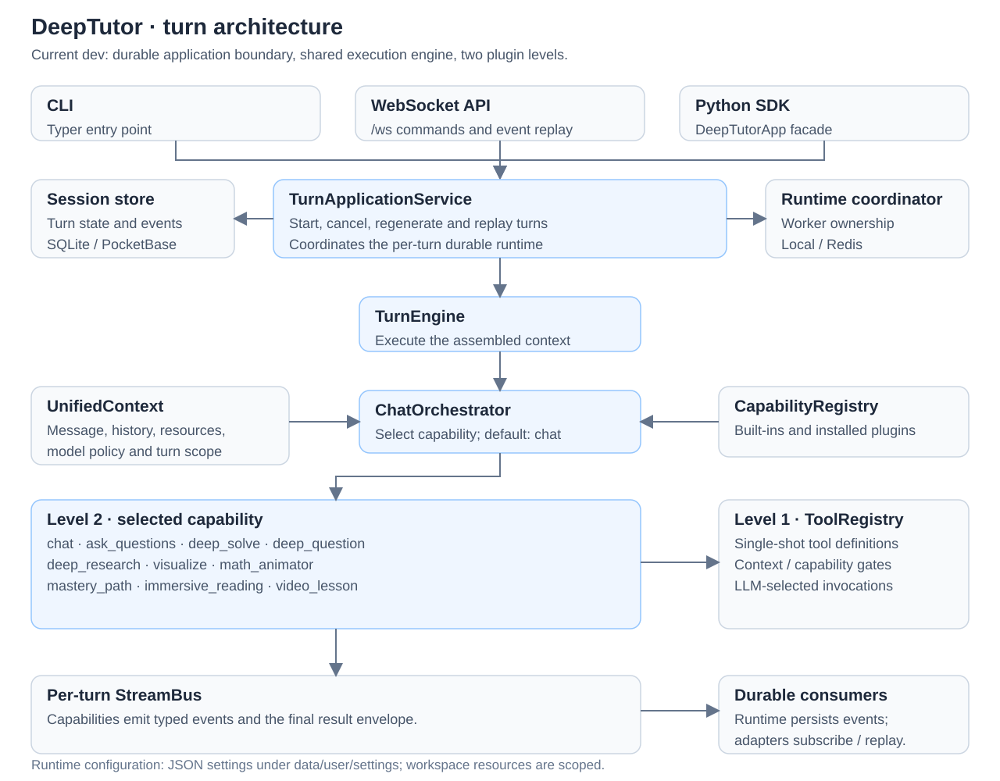

<div align="center">


<h1>DeepTutor: Yaşam Boyu Kişiselleştirilmiş Öğrenme</h1>

[English](../../README.md) · [简体中文](README_CN.md) · [繁體中文](README_TW.md) · [日本語](README_JA.md) · [Español](README_ES.md) · [Français](README_FR.md) · [العربية](README_AR.md) · [Русский](README_RU.md) · [हिन्दी](README_HI.md) · [Português](README_PT.md) · [ไทย](README_TH.md) · [Polski](README_PL.md) · **Türkçe**

[Belgeler](https://deeptutor.info/) · [Sürümler](https://github.com/HKUDS/DeepTutor/releases) · [Discord](https://discord.gg/eRsjPgMU4t) · [Katkıda bulunma](../../CONTRIBUTING.md)

</div>

[Özellikler](#özellikler) · [Başlangıç](#başlangıç) · [Öğrenme alanları](#öğrenme-alanları) · [CLI](#komut-satırı-ve-ajan-kullanımı) · [Ekosistem](#ekosistem-eduhub-ve-beceriler) · [Topluluk](#topluluk-ve-katkı)

DeepTutor; özel ders, araştırma, içerik üretimi ve alıştırmayı aynı genişletilebilir sistemde bir araya getiren, ajan temelli bir öğrenme alanıdır. CLI, WebSocket API ve Python SDK aynı çalışma motorunu kullanır. İstediğiniz sağlayıcı ve modellerle çalışabilir, kendi kaynaklarınızı bağlayabilir ve öğrenme sürecinizi takip edebilirsiniz.

Bu Türkçe kılavuz güncel kurulum yollarını ve temel iş akışlarını anlatır. Ayrıntılı özellik gösterimleri ve tarihli sürüm geçmişi için [İngilizce README'ye](../../README.md), yayımlanmış değişiklikler için [sürüm notlarına](https://github.com/HKUDS/DeepTutor/releases) bakın.

> 🤝 **Projeye bakım sorumluları aranıyor!** Roller, gereksinimler ve başvuru için [katkı kılavuzunu](../../CONTRIBUTING.md#join-the-team) inceleyin.

## Özellikler

- **Tek çalışma motoru, farklı öğrenme biçimleri:** Sohbet, Sınav, Araştırma, Görselleştirme, Çözüm, Ustalık Yolu ve Okuma; amaca özel akışlarını korurken oturum bağlamını paylaşır.
- **Bağlantılı öğrenme alanı:** Ana Sayfa, Öğrenme ve Kaynaklar; sohbetleri, kitapları, okumayı, alıştırmaları, görev panosunu, takvimi ve öğrenme not defterini ortak materyal ve ilerlemeyle birleştirir.
- **Kaynaklara dayanan bilgi:** LlamaIndex, PageIndex, GraphRAG veya LightRAG ile sürümlü kütüphaneler kurun, dış bilgi kaynaklarını bağlayın. Belge, video ve seslerin yanında kaynak bağlantılı atıflarla öğrenin.
- **Partnerler ve alt ajanlar:** Claude Code, Codex ve Grok CLI gibi ajanlara canlı danışın; geçmiş konuşmaları içe aktarın veya kendi belleği, kaynakları ve mesajlaşma kanalları olan kalıcı partnerler çalıştırın.
- **İncelenebilir bellek:** L1 izleri, L2 olguları ve L3 sentezi kişiselleştirmeyi görünür ve düzenlenebilir kılar. Bellek Grafiği'nde kanıt bağlantılarını inceleyebilirsiniz.
- **Genişletilebilir yapı:** Kişilikler, yerleşik veya topluluk becerileri, MCP hizmetleri, CLI uygulamaları ve üretim modelleri ekleyin.



## Başlangıç

Kullanımınıza uygun kurulum yolunu seçin. Terminal kurulumlarında özel ayarlar, başlatma dizininin altındaki `data/user/settings/` içinde tutulur. Konumu `DEEPTUTOR_HOME` veya `deeptutor start --home` ile belirleyebilirsiniz. Başladıktan sonra **Settings → Providers** ve **Language models** bölümlerinden sağlayıcı ve modeli yapılandırın.

Türkçe arayüz ve yanıt dili desteklenir. Arayüz diliyle model yanıt dili ayrı tercihlerdir; ilgili dil ayarlarında **Türkçe** seçin.

### Masaüstü: macOS ve Windows (önizleme)

**Open DeepTutor**, Python, Node.js ve tam öğrenme alanını birlikte sunar. Ayrı bir çalışma ortamı veya terminal kurulumu gerekmez. Bilgisayarınıza uygun paketi [son GitHub sürümünden](https://github.com/HKUDS/DeepTutor/releases/latest) indirin.

| Bilgisayar | Hedef | Kurulum |
| --- | --- | --- |
| Apple Silicon Mac | `macos-arm64` | DMG'yi açıp **Open DeepTutor** uygulamasını **Applications** klasörüne sürükleyin. |
| Intel Mac | `macos-x64` | DMG'yi açıp uygulamayı **Applications** klasörüne sürükleyin. |
| Windows x64 | `windows-x64` | Setup `.exe` dosyasını çalıştırın veya taşınabilir ZIP'i çıkarıp `Open DeepTutor.exe` dosyasını açın. |

Geliştirme önizlemeleri için başarılı bir [Desktop Release çalışmasından](https://github.com/HKUDS/DeepTutor/actions/workflows/desktop-release.yml?query=branch%3Adev) uygun Artifact dosyasını indirin. Bunlar GitHub girişi gerektirir ve yedi gün sonra silinir; yayımlanmış sürüm indirmelerinde bu sınır yoktur.

Windows önizleme paketleri imzasızdır; SmartScreen uyarısı gösterebilir. İmzalama, yerel veriler ve kaynak derlemeleri için [masaüstü kılavuzuna](../../apps/desktop/README.md) bakın.

### Docker: tam uygulamayı hızlıca deneme

Python veya Node.js kurmadan Web uygulamasını çalıştırın:

```bash
docker run --rm --name deeptutor \
  -p 127.0.0.1:3782:3782 \
  -v deeptutor-data:/app/data \
  ghcr.io/hkuds/deeptutor:latest
```

[http://127.0.0.1:3782](http://127.0.0.1:3782) adresini açın. Adlandırılmış birim ayarları ve yerel verileri korur. Web uygulaması için yalnızca `3782` portu gerekir. Ana bilgisayar klasörleri, yerel model hizmetleri, ters proxy ve üretim dağıtımı için [Docker kılavuzunu](https://docs.deeptutor.info/get-started/docker/) inceleyin.

### PyPI: Web uygulaması ve CLI

**Python 3.11–3.14** ve **Node.js 20.9+** kullanın. Modüler 1.7.0 ailesinde `deeptutor[full]` Web uygulaması ve CLI'yi; yalnızca `deeptutor` ise temel sohbet ve SDK'yı kurar.

```bash
mkdir -p my-deeptutor && cd my-deeptutor
python -m pip install -U "deeptutor[full]"
deeptutor init
deeptutor start
```

`init`, portları, LLM sağlayıcısını ve isteğe bağlı gömme/arama hizmetlerini ayarlar. Terminalde yazan URL'yi açın; varsayılan adres [http://127.0.0.1:3782](http://127.0.0.1:3782) olur. İki hizmeti de durdurmak için `Ctrl+C` kullanın.

**1.6.15 veya daha eski sürümden geçiş:** DeepTutor'u durdurun, çalışma dizinini yedekleyin ve yeni paket ailesini kurmadan önce eski `deeptutor-cli` paketini kaldırın. Aynı `DEEPTUTOR_HOME` değerini koruyun. Ardından `python -m pip check` ve `deeptutor module list` çalıştırın. Kesin yükseltme komutları [PyPI ve geçiş kılavuzundadır](https://docs.deeptutor.info/get-started/pypi/).

### Kaynak kod: geliştirme ve katkı

CI ve Docker ile uyum için **Python 3.11–3.14** ve **Node.js 22 LTS** kullanın:

```bash
git clone --branch dev https://github.com/HKUDS/DeepTutor.git
cd DeepTutor
python3 -m venv .venv && source .venv/bin/activate
python -m pip install --upgrade pip
python -m pip install -r requirements/full.txt
python -m pip install -e . --no-deps
( cd web && npm ci --legacy-peer-deps )
deeptutor init
deeptutor start --dev
```

Üretim derlemesi için `--dev` olmadan `deeptutor start` kullanın. İsteğe bağlı bağımlılıkları deponun kökünden kurun:

```bash
python scripts/install_extras.py dev,partners,math-animator
```

Conda, ek bağımlılıklar ve sorun giderme için [kaynaktan kurulum kılavuzuna](https://docs.deeptutor.info/get-started/from-source/) bakın. Terminal kullanabilen bir ajanın kurulumu yapıp doğrulaması için [Ajan Kurulumu](../../docs-for-dev/AGENT_SETUP.md) belgesini kullanabilirsiniz.

### Yalnızca CLI

En küçük terminal kurulumu için temel paketi kullanın; Node.js veya Web arayüzü gerekmez:

```bash
mkdir -p my-deeptutor && cd my-deeptutor
python -m pip install -U deeptutor
deeptutor init --cli
deeptutor chat
```

Temel paket; Sohbet, Soru Sor, CLI ve SDK'yı içerir. Diğer yetenek ve yönetim komutları ilgili özellik modüllerini gerektirir. Kaynak kurulumu ve isteğe bağlı bağımlılıklar için [CLI kılavuzuna](https://docs.deeptutor.info/get-started/cli-only/) bakın.

Gelişmiş kurulum: [İçerik çalışma alanları](../../docs-for-dev/workspaces.md), [yerel veriler](../../docs-for-dev/DATA_STORAGE.md), [konteyner ve yalıtım](../../docs-for-dev/CONTAINERIZATION.md), [ayar dosyaları](https://docs.deeptutor.info/get-started/pypi/#config-files-under-datausersettings), [sorun giderme](https://docs.deeptutor.info/get-started/troubleshooting/).

## Öğrenme alanları

Her ders veya proje için bir **çalışma alanı** oluşturun. Ana Sayfa, Öğrenme ve Kaynaklar etkin alana göre değişir. Partnerler ve Kişiselleştirme, alanlar arasında kullanılabilir.

| Bölüm | Kapsam | İçerik |
| --- | --- | --- |
| Ana Sayfa | Çalışma alanı | Sohbet, Görev Panosu, Takvim ve öğrenme not defteri |
| Öğrenme | Çalışma alanı | Kitaplar, Ustalık Yolu, Sürükleyici Okuma ve Alıştırma |
| Kaynaklar | Çalışma alanı | Sohbet geçmişi, favoriler, öğrenme günlüğü, soru bankası ve bilgi merkezi |
| Partnerler | Hesap | Kalıcı yardımcılar, partner grupları, kaynak erişimi ve mesajlaşma kanalları |
| Kişiselleştirme | Hesap | Ajanlarım, kişilikler, beceriler, MCP, CLI uygulamaları, bellek ve ayarlar |

### Sohbet, görevler ve notlar

Sohbet günlük kullanımın başlangıç noktasıdır. Aynı oturumda öğrenme araçlarını kullanın; görev panosunda sonraki adımları düzenleyin ve not defterinde kendi notlarınızı geliştirin. Takvim, çalışma olaylarının kaynak alanını korurken hesap genelinde görünüm sunar.

### Kitaplar, Ustalık Yolu ve Okuma

Kitaplar kaynaklardan yapılandırılmış öğrenme içeriği üretir. Ustalık Yolu, öğrenmeyi adımlara ve değerlendirmelere ayırır. Okuma, belgeyi veya desteklenen video/ses içeriğini öğrenme konuşmasının yanında tutar. Kaynaklara bağlı atıflarla açıklamaları kontrol edebilirsiniz. Alıştırmalar ve soru bankası tekrar çalışmayı destekler.

### Bilgi merkezleri ve kaynaklar

Yerel belgelerden bilgi bankaları oluşturun veya desteklenen harici kaynakları bağlayın. LlamaIndex, PageIndex, GraphRAG ve LightRAG farklı indeksleme/getirme yaklaşımları sunar. Belge ayrıştırma, gömme modelleri ve getirme ayarları sonuçları etkiler; ilgili modüllerin kurulu, etkin ve hazır olduğundan emin olun.

### Partnerler, ajanlar ve bellek

Kendi kişiliği, belleği, kaynakları ve mesajlaşma kanalları olan kalıcı partnerler kurabilirsiniz. Ajanlarım üzerinden desteklenen yerel/uzak ajan bağlantılarına danışabilirsiniz. Bellek katmanları ve kanıt bağlantıları, kişiselleştirmenin nereye dayandığını incelemenizi sağlar.

### Yönetim ve ortak kurulumlar

Yönetici ve normal kullanıcıların yetkileri farklıdır. Paylaşılan dağıtımlarda hesapları, kaynak izinlerini ve kullanıcıya özel kimlik bilgilerini yapılandırın; bir yöneticinin ayarının herkese açık olduğunu varsaymayın. PocketBase entegrasyonu tek kullanıcılıdır; harici kullanıcı deposu bağlamadıysanız çok kullanıcılı kurulumlarda `integrations.pocketbase_url` değerini boş bırakın. Ayrıntılar [İngilizce README'nin yönetim bölümündedir](../../README.md#️-administration--shared-deployments).

## Komut satırı ve ajan kullanımı

`deeptutor chat` etkileşimli REPL'i açar; `deeptutor run <capability> "<message>"` bir yetenek turu çalıştırıp çıkar. İkisi de `--tool`, `--kb`, `--config` ve kayıtlı çalışma alanı seçimi için `--workspace` kabul eder.

```bash
deeptutor chat
deeptutor chat --capability deep_solve --kb my-kb
deeptutor run chat "Explain the Fourier transform" --kb textbook
deeptutor run deep_research "Survey 2026 papers on RAG" \
  --config mode=report --config depth=standard
```

`--kb`, otomatik RAG ve Knowledge Frontier araçlarına bağlam sağlar. Frontier hem bilgi hem araştırma modülünü gerektirir. `--tool`, kullanıcının açıp kapatabildiği araçları seçer.

Başka bir ajanın DeepTutor'u araç olarak kullanması için `run` komutuna `--format json` ekleyin. Her satırında bir olay bulunan **NDJSON** döner (`content`, `tool_call`, `tool_result`, `done` vb.); satırlar `session_id` taşır. TTY olmayan ortamda `ask_user` beklemesi boş yanıtla çözülür; süreç askıda kalmaz.

Ajanınızdan kökteki [SKILL.md](../../SKILL.md) dosyasını açıkça okumasını isteyin. Kurulum için [Ajan Kurulumu](../../docs-for-dev/AGENT_SETUP.md), ayrıntılı kullanım için [Agent Handoff](https://deeptutor.info/docs/cli/agent-handoff/) belgesine bakın. `deeptutor run` komutunu LangChain / AutoGen döngüsünde araç olarak da sarmalayabilirsiniz.

| Komut | İşlev |
| --- | --- |
| `deeptutor init [--non-interactive] [--home PATH]` | Sihirbazı çalıştırır veya soru sormadan eksik varsayılanları oluşturur |
| `deeptutor doctor [--online]` | Hazırlık kontrolü; `--online` model sağlayıcısını da sınar, `--format json` rapor üretir |
| `deeptutor start [--home PATH] [--dev] [--detach] [--no-browser]` | Arka uç ve arayüzü birlikte başlatır |
| `deeptutor stop [--home PATH]` | `--detach` ile başlatılmış hizmeti durdurur |
| `deeptutor serve [--port PORT]` | Yalnızca FastAPI arka ucunu başlatır |
| `deeptutor module list/install/uninstall/enable/disable` | Modülleri inceler ve değiştirir; DeepTutor durdurulmalıdır |
| `deeptutor workspace show/set/reset` | Kullanıcıya ait içerik alanını gösterir, seçer veya sıfırlar |
| `deeptutor run <capability> <message>` | Tek yetenek turu çalıştırır |
| `deeptutor partner list/create/start/stop` | Mesajlaşma bağlantılı partnerleri yönetir |
| `deeptutor kb list/info/create/add/search/delete` | Bilgi bankalarını yönetir; ek senkronizasyon ve değerlendirme komutları da vardır |
| `deeptutor skill search/install/list/remove/login/logout/publish/update` | Becerileri bulur, kurar ve yönetir |
| `deeptutor memory show/clear` | Belleği inceler veya temizler |
| `deeptutor session list/show/open/rename/delete` | Oturumları yönetir |
| `deeptutor notebook list/create/show/add-md/replace-md/remove-record` | Not defterlerini yönetir |
| `deeptutor book list/health/refresh-fingerprints` | Kitapları ve kaynak parmak izlerini inceler |
| `deeptutor plugin list/info/state/search/show/install/approve/enable/disable/rollback/uninstall` | Eklentileri ve izinlerini yönetir |
| `deeptutor config show [--home PATH]` | Kimlik bilgilerini gizleyerek etkin ayarları gösterir |
| `deeptutor config providers` | Desteklenen sağlayıcıları ve varsayılanları JSON olarak listeler |
| `deeptutor config apply FILE [--check] [--home PATH]` | JSON ayarını uygular veya yazmadan doğrular |
| `deeptutor provider login <provider>` | Sağlayıcıya giriş yapar |

GitHub Copilot kimlik bilgileri giriş yapan DeepTutor sahibine aittir ve yalıtılmış alanların dışında, `<runtime-home>/data/system/user-secrets/<owner-id>/private/github-copilot/credentials.v1.json` yolunda saklanır. Diğer kullanıcılar ayrı giriş yapar; Copilot profilleri model izinleriyle paylaşılamaz. Harici nanobot/Copilot token dosyaları içe aktarılmaz; yükseltmeden sonra `deeptutor provider login github-copilot` komutunu yeniden çalıştırın. GitHub girişinin başarılı olması tek başına Copilot model erişimi olduğunu göstermez; çıkarım ayrıca doğrulanır.

### Modüller

Temel paket CLI ve SDK'yı sağlar; `deeptutor-cli` uyumluluk için meta pakettir. İsteğe bağlı dağıtımlar araç, yetenek, API yolu, arka plan hizmeti ve gezinme ekler. Modüller aynı Python ortamını paylaşır; sürümleri temel paketle eşleşmelidir.

Modül değişikliklerinden önce DeepTutor'u durdurun. Aynı Python ortamını ve `DEEPTUTOR_HOME` değerini kullanın. Kaynak kurulumları etkinleştirme/devre dışı bırakmayı; wheel ortamları kurma/kaldırmayı da destekler. Devre dışı bırakma veya kaldırma ayarları, konuşmaları, bilgi bankalarını ve üretilen dosyaları korur. Bağımlı modüller kaldırmayı engeller; temel paket bu komutla kaldırılamaz. Ortak üçüncü taraf bağımlılıklar tutulur.

Tarayıcıda **Settings → Runtime status → Modules**, durumları ve terminal komutlarını gösterir. **Chat → Customize page** ve **Learning → New learning activity → Customize page** kişisel sayfa seçimlerini değiştirir; bir girdiyi gizlemek modülünü kaldırmaz veya erişimi iptal etmez. Yerel wheel kurulumunda `module install` için `--wheelhouse /path/to/wheels` kullanın. [Modül kılavuzu](../../docs-for-dev/MODULES.md).

### Görsel inceleme

`enable_visual_review=true`, Manim çıktılarında okunabilirlik, üst üste binme ve kadraj kontrolü sağlar; varsayılan `false` değeridir. `math_animator` için `output_mode=image`, `visualize` için `render_mode=manim_image` ile de çalışır; genel `auto` döngüsü dahil diğer görselleştiriciler bunu yok sayar. Manim'in isteğe bağlı bağımlılıkları gerekir.

SDK'da `TurnRequest` yapılandırmasına `config={"enable_visual_review": True}`, API'de aynı nesneye JSON `true` verin. Kitap animasyon bloğunda `params={"enable_visual_review": True}` kullanın. Ek model, onarım ve yeniden çizim çağrıları maliyeti ve gecikmeyi artırabilir. En fazla dört yeniden deneme, 120 saniye inceleme ve 180 saniye onarım zaman aşımı uygulanır. Kare yoksa veya model görüntü inceleyemiyorsa kontrol özetle atlanır. Tüm denemelerden sonra başarısızlıkta en iyi mevcut çizim ve başarısız sonuç döner. Sonuç `render.visual_review`, kitapta `metadata.visual_review` içinde tutulur; çalışmadıysa `null` olur.

## Ekosistem: EduHub ve beceriler

Beceriler açık **Agent-Skills** biçimini kullanır: YAML ön bilgili bir `SKILL.md` ve isteğe bağlı başvuru dosyaları içeren klasör. Eğitim odaklı [EduHub](https://eduhub.deeptutor.info/) varsayılan merkezdir. Sokratik öğretmenler, bilgi kartları, yazı geri bildirimi, sınav planları ve kavram açıklayıcıları paylaşabilirsiniz.

Tarayıcıda **Personalization → Skills → Import from EduHub** yoluyla içe aktarın. Terminalden:

```bash
deeptutor skill search socratic
deeptutor skill install eduhub:socratic-tutor
```

EduHub ayrıca ClawHub uyumlu, bağımsız bir kayıt merkezidir. Diğer ajanlar `npx eduhub install socratic-tutor` ile kullanabilir. [ClawHub](https://clawhub.ai/) da yerleşik kaynak olarak desteklenir; kurulum başvurusunda merkez önekini seçin. Aynı kısa adı kullanan yayıncılarda kapsamlı `clawhub:<ownerHandle>/<slug>` başvurusunu kullanın.

Her içe aktarma aynı güvenlik kapısından geçer:

- Merkezin güvenlik kararı kontrol edilir; işaretlenmiş paketler `--allow-unverified` olmadan reddedilir.
- Arşivlerde dizin dışına çıkma, öğe sayısı, boyut, sıkıştırma oranı, uzantı ve sembolik bağlantı kontrolleri yapılır. Çalıştırma bitleri kaldırılır; uzantısız dosyalara izin verilir.
- Ön bilgi normalleştirilir, `always:` kaldırılır; indirilen beceri kendini her sistem istemine zorla ekleyemez.
- Merkez, sürüm, karar ve kurulum zamanı `.hub-lock.json` içine yazılır.

Çok kullanıcılı kurulumlarda tarayıcıdan içe aktarma giriş yapan kişinin beceri katmanına gider. CLI ve yönetici konsolu kurulumları sahip/yönetici alanını hedefler; yönetici becerileri izin verilene kadar normal kullanıcılardan gizlidir ve salt okunurdur.

`data/user/settings/skill_hubs.json` dosyasına başka merkezler ekleyebilirsiniz. `type: "clawhub"` uyumlu HTTP API'sini, `type: "command"` merkezin getirme CLI'sini kullanır. `"default"`, öneksiz kısa adların merkezini belirler. Hepsi aynı güvenlik kapısından geçer.

## Topluluk ve katkı

DeepTutor, [HKUDS](https://github.com/HKUDS) grubu içinde [Bingxi Zhao](https://github.com/pancacake) liderliğinde geliştirilen açık kaynak projesidir. Toplulukla birlikte tamamen açık kaynaklı biçimde ilerler. Şu anda hiçbir türde ücretli çevrimiçi ürünümüz yoktur. Görüş, fikir ve iş birliği için **bingxizhao39@gmail.com** adresine ulaşabilirsiniz.

HKU Veri Zekâsı Laboratuvarı yöneticisi [Chao Huang](https://sites.google.com/view/chaoh) ve HKUDS ekibine; özellikle [Jiahao Zhang](https://github.com/zzhtx258), [Zirui Guo](https://github.com/LarFii) ve [Xubin Ren](https://github.com/Re-bin) isimlerine teşekkürler. Açık kaynak topluluğunun yıldızları, hata bildirimleri, PR'ları ve tartışmaları projeyi şekillendiriyor.

LlamaIndex, nanobot, LightRAG, AutoAgent, AI-Researcher, OpenClaw, Codex, Claude Code ve ManimCat projeleri hem araç hem ilham sağladı. Proje bağlantıları ve iş ortakları [İngilizce README'de](../../README.md#-open-source-partners) listelenir.

[Yol haritasında](https://github.com/HKUDS/DeepTutor/issues/498) maddelere oy verebilir veya yenilerini önerebilirsiniz. Dal düzeni, standartlar ve başlangıç için [katkı kılavuzuna](../../CONTRIBUTING.md) bakın. PR'lar `dev` dalını hedeflemelidir. Son katkılar [CONTRIBUTORS.md](../../CONTRIBUTORS.md) içindedir.

[Apache License 2.0](../../LICENSE) ile lisanslanmıştır.
