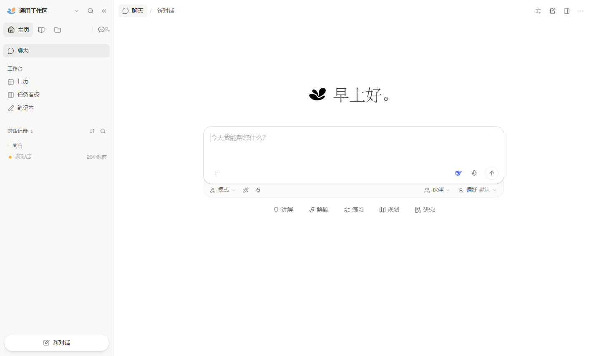

# DeepTutor Desktop

An Electron shell that turns the DeepTutor web workspace into a Windows / macOS / Linux desktop application.

The shell owns **no product logic**. It starts the two processes DeepTutor needs — the FastAPI backend and the Next.js standalone server — loads `http://127.0.0.1:<frontendPort>` exactly like a browser would, and adds the desktop-only surface: windows, menus, tray, persisted preferences and a controlled bridge for external links.



## Architecture

```
┌──────────────────────────── Electron main process ─────────────────────┐
│ index.js         startup orchestration: single instance, lifecycle      │
│ service-manager  supervises both child processes, health probes,        │
│                  attach / managed modes                                 │
│ window-manager   window lifecycle, geometry persistence, splash/error   │
│ menu / tray      application menu, system tray, status mirroring         │
│ ipc.js           the renderer's only entry point: allowlist + validation │
│ config-store     userData/config.json, atomic writes, schema coercion    │
│ external-links   navigation guard: in-app allowed, off-site → browser    │
└────────────────────────────────┬────────────────────────────────────────┘
                                 │ IPC (invoke / events, all allowlisted)
┌────────────────────────────────┴────────────────────────────────────────┐
│ preload (sandbox: true) → contextBridge exposes a fixed window.deeptutor │
└────────────────────────────────┬────────────────────────────────────────┘
                                 │ http://127.0.0.1:<frontendPort>
┌────────────────────────────────┴────────────────────────────────────────┐
│ renderer: the DeepTutor web UI (contextIsolation, no Node access)        │
└─────────────────────────────────────────────────────────────────────────┘
                                 │ /api/* is reverse-proxied by the Next server
┌─────────────────────────────────────────────────────────────────────────┐
│ backend child: uvicorn deeptutor.api.main:app  (default :8001)           │
│ UI child:      node standalone/server.js        (default :3782)          │
└─────────────────────────────────────────────────────────────────────────┘
```

## Layout

```
desktop/
├── src/main/              main process, split by responsibility
│   ├── index.js           CLI flags, single instance, startup/shutdown
│   ├── service-manager.js backend/UI supervision, health checks, restarts
│   ├── window-manager.js  window creation, splash/error pages, geometry
│   ├── menu.js            application menu
│   ├── tray.js            tray icon and status
│   ├── ipc.js             IPC allowlist and payload validation
│   ├── config-store.js    JSON preferences (atomic write, schema coercion)
│   ├── external-links.js  navigation, window-open and permission policy
│   ├── runtime-paths.js   locates home / Python / web bundle / Node runtime
│   ├── logger.js          file + in-memory logs
│   └── smoke.js           smoke harness (loaded only with --smoke)
├── src/preload/index.js   contextBridge surface
├── src/renderer/          splash.html / error.html
├── scripts/               prepare-web.mjs, smoke-test.js, version.mjs,
│                          make-shortcut.py + lnk.py (optional Windows helper)
├── build/                 app icon, tray icons, macOS entitlements
└── electron-builder.yml   packaging for the three platforms
```

## Requirements

- Node.js ≥ 20 (for Electron and electron-builder)
- Python ≥ 3.11 with DeepTutor installed (`pip install -e .`). A checkout-local `.venv` is detected automatically.
- A built web bundle: `npm run prepare:web` builds `web/` and copies `static/` + `public/` into the standalone output.

## Run from source

```bash
cd desktop
npm install
npm run prepare:web    # build the web UI into web/.next-deeptutor/standalone
npm start
```

`npm start` is a foreground dev run; `npm run dev` opens with the DevTools entry enabled.

### Service supervision

On startup the shell probes both ports and picks the cheapest path:

| Situation | Behaviour |
| --- | --- |
| A DeepTutor instance already listens (e.g. `deeptutor start` in a terminal) | **attach** — reuse it, spawn nothing |
| Backend up, UI down | spawn only the UI child |
| Port taken but unresponsive (e.g. a stale `next dev` still compiling) | wait up to 25 s, then fail with "port is occupied by another program" instead of spawning a child that can only collide |
| Neither | **managed** — start the backend, wait for health, then start the UI |

The window shows a splash page (probing → backend → UI → loading) until the service reports ready, and an error page with a retry button if startup fails.

### CLI flags

```
--home=<path>            DeepTutor workspace root
--python-path=<path>     interpreter that can import deeptutor
--backend-port=<port>    default 8001
--frontend-port=<port>   default 3782
--user-data=<path>       override userData (useful for isolated runs)
--dev                    enable the DevTools entry
--no-tray                do not create a tray icon
--no-reuse               always start a fresh stack
--disable-gpu            forward to Chromium
```

## Security model

- `contextIsolation: true`, `nodeIntegration: false`, `sandbox: true`, `webviewTag: false`. The renderer never sees `require` / `process`; only `window.deeptutor` exists.
- preload exposes **fixed methods only** — `ipcRenderer` is never handed out. Every channel is registered in `ipc.js`; unknown channels are rejected, and event subscriptions go through the same allowlist.
- The main process validates every payload (`shell:openExternal` accepts only `http/https/mailto`, `config:set` only knows declared keys) and answers with `{ ok: false, error }` instead of throwing into the page.
- Navigation guard: in `will-navigate` / `will-redirect` / `setWindowOpenHandler`, off-site URLs are cancelled and handed to the system browser; in-app popups are allowed but **without** preload.
- Permission requests are denied by default; only `media`, `fullscreen`, `clipboard-sanitized-write` and `notifications` are granted.
- Children start with a minimal environment (`DEEPTUTOR_HOME`, `DEEPTUTOR_API_BASE_URL`, …) and are reaped as a process tree on exit (`taskkill /T` on Windows, process-group signals on POSIX).

## Configuration

Preferences live in `app.getPath('userData')/config.json` (`%APPDATA%/DeepTutor/config.json` on Windows). Writes are atomic (temp file + rename); a corrupt file is moved aside to `config.json.corrupt` and the defaults are restored.

| Key | Meaning |
| --- | --- |
| `window.{width,height,x,y,maximized,zoomFactor,alwaysOnTop}` | geometry and zoom, saved on close |
| `service.home` | DeepTutor workspace root (empty = auto-detect) |
| `service.pythonPath` | interpreter that can import `deeptutor` (empty = auto-detect `.venv`) |
| `service.backendPort` / `frontendPort` | local ports, default 8001 / 3782 |
| `service.reuseRunning` | reuse a running instance (default true) |
| `service.startTimeoutMs` | startup deadline, default 180 s |
| `service.extraEnv` | extra environment for the children (e.g. remote `DEEPTUTOR_API_BASE_URL`) |
| `behavior.closeToTray` / `minimizeToTray` | hide to tray instead of quitting |
| `behavior.launchAtLogin` | start at login (toggle in the tray menu) |
| `behavior.confirmQuit` | ask before quitting |
| `behavior.restoreLastUrl` | reopen the last route |

The menu, the tray and IPC (`config:get/set/reset`) all read and write this file and broadcast `config:changed` afterwards.

## Windows, menu and tray

- Single instance: a second launch focuses the existing window.
- Menu: File (new window, open in browser, restart services), Edit, View (reload, zoom, fullscreen, DevTools), Window, Help (docs, log folder, config folder, workspace, diagnostics, about).
- Tray: status text (stopped / probing / starting / ready / failed), show window, open in browser, restart services, open logs, close to tray, launch at login, quit.

## Packaging

```bash
npm run dist:win      # NSIS installer + portable (x64 / arm64)
npm run dist:mac      # dmg + zip (x64 / arm64, hardened runtime)
npm run dist:linux    # AppImage + deb
npm run dist:all      # all three (needs each OS or a CI matrix)
```

Artifacts land in `release/<version>/`. `desktop/package.json` takes its version from `deeptutor/__version__.py` — `npm run version:sync` (already wired into the `pack`/`dist*` scripts) keeps them equal.

Notes learned the hard way:

- `extraResources` copies `../web/.next-deeptutor/standalone` into `resources/web`; the shell itself is a few hundred KB and has no runtime npm dependencies.
- **`node_modules` inside `extraResources` needs its own `from` entry** (`standalone/node_modules → web/node_modules`). electron-builder's glob matcher drops any `node_modules` path segment, and the packaged server then dies on `Cannot find module 'next'`.
- **The Python backend is not bundled.** Three ways to supply it:
  1. the target machine already has DeepTutor — fill in or auto-detect `service.home`;
  2. freeze it with PyInstaller/Nuitka into `resources/backend/deeptutor-server(.exe)`; `runtime-paths.bundledBackend()` prefers it;
  3. point `service.extraEnv.DEEPTUTOR_API_BASE_URL` at a remote backend.
- Signing: macOS uses `hardenedRuntime` + `build/entitlements.mac.plist` with `CSC_LINK` / `CSC_KEY_PASSWORD`; Windows uses `WIN_CSC_LINK`. Unsigned builds need a right-click open on macOS and trip SmartScreen on Windows.
- Icons are committed (`build/icon.ico`, `build/icon.png`, `build/tray*.png`), so packaging never downloads an icon bundle. Offline/behind-a-mirror builds can pin both the Electron distribution and the builder binaries:

```bash
ELECTRON_BUILDER_BINARIES_MIRROR=<mirror> \
npx electron-builder --dir --win --config.electronDist=node_modules/electron/dist
```

- A GitHub Actions matrix that mirrors the above:

```yaml
strategy:
  matrix:
    os: [windows-latest, macos-latest, ubuntu-latest]
steps:
  - uses: actions/checkout@v4
  - uses: actions/setup-node@v4
    with: { node-version: 22 }
  - run: cd web && npm ci && npm run build
  - run: cd desktop && npm ci && npm run version:sync && npx electron-builder --publish never
    env:
      CSC_LINK: ${{ secrets.CSC_LINK }}
      CSC_KEY_PASSWORD: ${{ secrets.CSC_KEY_PASSWORD }}
```

## Verification

```bash
npm run smoke
```

This really launches the app against an isolated `userData` directory, waits for the service, loads the UI and then asserts ten things: preload bridge present, IPC round-trip, shell marker, rendered text, interactive elements, mounted layout, `/api/*` reachable through the proxy, sidebar navigation, no 5xx responses, no console errors. It captures a screenshot, writes `artifacts/smoke-report.json` and exits non-zero on any failed check.

Measured on Windows with the production bundle:

| Scenario | Flags | Result |
| --- | --- | --- |
| attach to a running instance | `--backend-port=8001 --frontend-port=3782` | reuses the instance, UI renders |
| managed (spawns the UI) | `--frontend-port=3882` | spawns standalone UI, reuses backend, 10/10 |
| cold start (spawns both) | `--backend-port=8102 --frontend-port=3883 --no-reuse` | backend ready in ~6 s, UI in ~1 s, no ports left behind |
| packaged build | `release/<version>/win-unpacked/DeepTutor.exe` | serves `resources/web`, 10/10, `/chat → /calendar` navigation passes |

## Optional: Windows shortcut helper

`npm run shortcut` (Python, Windows only) writes a `DeepTutor Desktop.lnk` that points at the newest `release/*/win-unpacked/DeepTutor.exe` (or falls back to the source checkout) and records `service.home` / `service.pythonPath` in the app config, so the shortcut needs no CLI flags. `--start-menu` also creates a Start Menu entry; `--remove` deletes what it created.

`scripts/lnk.py` implements the `.lnk` writer directly because a shell that only emits the `LinkInfo` block is rejected by ShellExecute (`ERROR_NO_ASSOCIATION`) — Windows also requires a real `LinkTargetIDList`, built here through `shell32.ILCreateFromPathW`.

## Troubleshooting

| Symptom | Check |
| --- | --- |
| splash stuck on "starting backend" | `%APPDATA%/DeepTutor/logs/desktop-*.log`; usually missing Python deps or a port clash |
| blank window, `/_next/static/*` 404 | the web bundle is missing `static/` — rerun `npm run prepare:web` |
| "no usable web bundle found" | `cd web && npm run build`, then rerun `npm run prepare:web` |
| port conflict | change `service.backendPort` / `service.frontendPort`, or restart from the tray |
| want a remote backend | set `service.extraEnv.DEEPTUTOR_API_BASE_URL` and keep `service.reuseRunning` true |

Logs are two-layered: shell logs go to `userData/logs/`, and the children's stdout/stderr are prefixed with `[backend:out]` / `[frontend:err]` in the same file.

## Limitations

- The shell targets the web UI only; the CLI and Python tooling keep their own entry points.
- `npm run smoke` needs a working desktop session on Windows/macOS; on headless Linux wrap it in `xvfb-run`.
- Packaging is verified on Windows. The macOS/Linux targets are configured but have not been exercised end to end here.
