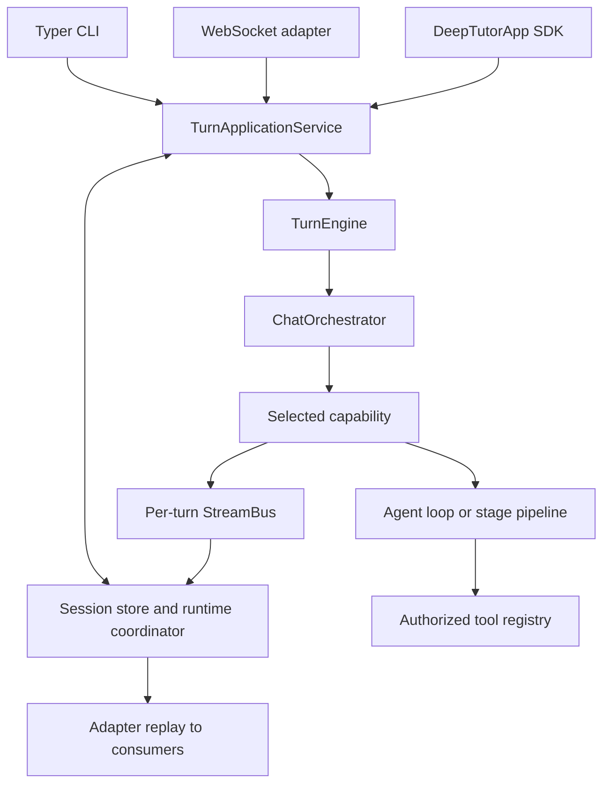

# Architecture and source owners

[Handbook](README.md) · [Development](DEVELOPMENT.md) · [Events](EVENTS_AND_PROGRESS.md)

DeepTutor 1.7.0 is one source repository with independently packaged Python
modules. CLI, WebSocket and Python SDK entry points converge on a durable
application service before executing a capability.

## Trace a request

| Responsibility | Source owner |
| --- | --- |
| CLI parsing and commands | [`deeptutor_cli/main.py`](../deeptutor_cli/main.py) |
| SDK facade and application requests | [`deeptutor/app/`](../deeptutor/app/) |
| Durable admission, execution and replay | [`app/service.py`](../deeptutor/app/service.py) |
| WebSocket adaptation | [`unified_ws.py`](../deeptutor/api/routers/unified_ws.py) |
| Lower-level execution | [`runtime/turn_engine.py`](../deeptutor/runtime/turn_engine.py) |
| Context-to-capability routing | [`runtime/orchestrator.py`](../deeptutor/runtime/orchestrator.py) |
| Capability/tool registration | [`runtime/registry/`](../deeptutor/runtime/registry/) |
| Module-owned contributions | [`modules/manifests/`](../deeptutor/modules/manifests/) |
| Shared chat loop | [`agents/loop/`](../deeptutor/agents/loop/) |
| Persistent sessions and turn lifecycle | [`services/session/`](../deeptutor/services/session/) |
| Worker leases and notifications | [`runtime/coordination/`](../deeptutor/runtime/coordination/) |

`UnifiedContext` in [`core/context.py`](../deeptutor/core/context.py) is the
execution context. Entry points should use the application service rather
than instantiate an orchestrator to bypass durable state. Persistence,
submission identity, replay, cancellation and recovery belong to the shared
application/runtime path. See [events](EVENTS_AND_PROGRESS.md) before changing
stream behavior.

## Tools, capabilities and modules

A tool is one model-selected operation. A capability owns a complete turn and
may run a shared loop or a multi-stage pipeline. `chat` is the default;
capability activation and context determine additional tool availability.
Every capability emits the common result envelope, including usage costs.
See [extension contracts](TOOLS_AND_CAPABILITIES.md).

Official [module manifests](MODULES.md#ownership-and-assembly) own package
paths, dependencies, capabilities, routers, CLI groups, navigation and
lifecycle callbacks. Installed, enabled and ready are separate states.
Metadata must be readable without importing unavailable feature packages.
Third-party [plugins](PLUGINS.md) add review and lifecycle rules of their own;
they are not the same as official module wheels.

## Configuration and isolation

[`runtime/home.py`](../deeptutor/runtime/home.py) resolves the runtime home;
[`services/config/runtime_settings.py`](../deeptutor/services/config/runtime_settings.py)
owns settings and supported process overrides. Runtime settings live under
`data/user/settings/`; `.env` is not an application configuration source.
Container startup has its own JSON-to-environment handling, described in
[Containerization](CONTAINERIZATION.md#runtime-configuration).

Account authorization and workspace selection are separate checks. Paths and
services resolve through [`services/workspace/`](../deeptutor/services/workspace/)
and [`services/path_service.py`](../deeptutor/services/path_service.py).
Selected workspace data, account credentials and shared resource grants have
different lifetimes; consult [storage](DATA_STORAGE.md) and
[workspace contracts](workspaces.md) before touching migrations or caches.

## Frontend boundaries

The Next.js App Router in [`web/app/`](../web/app/) composes pages. Domain,
store and transport slices live under [`web/features/`](../web/features/).
Reusable UI and transport primitives live under [`web/shared/`](../web/shared/).
[`web/contracts/`](../web/contracts/) holds generated API and turn contracts.

The [dependency rules](../web/.dependency-cruiser.cjs) prohibit cycles,
imports of route `page.tsx` modules, upward dependencies from shared code,
and rendering-layer imports from feature domain/store/transport code except
for the named settings-store exception. Prefer existing transport and store
owners to component-local WebSocket, retry or persistence implementations.

[`web/proxy.ts`](../web/proxy.ts) forwards API/WebSocket traffic to the
backend. Browser settings and runtime server configuration are different
boundaries; do not bake deployment addresses or secrets into client code.

## Experimental engine path

The Python scheduler remains the default. `DEEPTUTOR_CHAT_ENGINE` can select
experimental TypeScript paths implemented in
[`packages/chat-engine/`](../packages/chat-engine/) and
[`runtime/ts_engine/`](../deeptutor/runtime/ts_engine/). The native path has
compatibility checks and Python integration points. An old migration plan is
not evidence that the whole backend has moved to TypeScript. Changes here
must preserve the application service, storage and public event contracts;
see the dedicated engine jobs in [Testing](TESTING.md).
