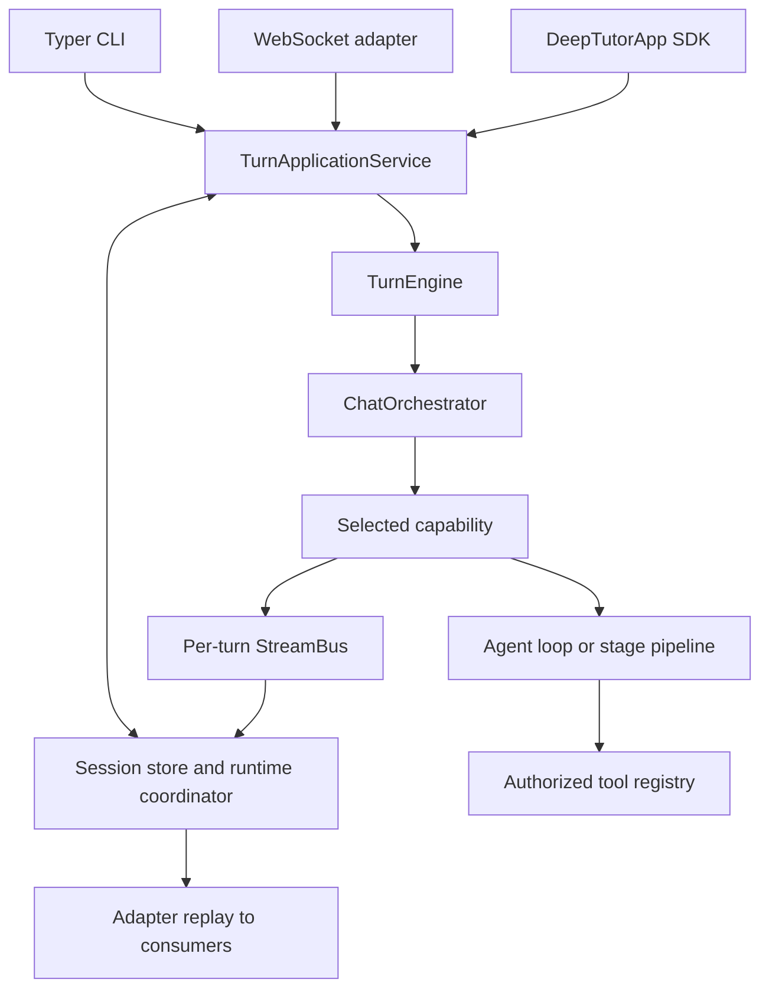

# Mimari ve kaynak sahipleri

[El kitabı](README.md) · [Geliştirme](DEVELOPMENT.md) · [Olaylar](EVENTS_AND_PROGRESS.md)

DeepTutor 1.7.0, bağımsız olarak paketlenen Python modüllerinden oluşan tek
bir kaynak deposudur. CLI, WebSocket ve Python SDK giriş noktaları, bir
yeteneği çalıştırmadan önce kalıcı bir uygulama servisinde birleşir.

## Bir isteğin izini sürme

| Sorumluluk | Kaynak sahibi |
| --- | --- |
| CLI ayrıştırma ve komutlar | [`deeptutor_cli/main.py`](../../deeptutor_cli/main.py) |
| SDK cephesi ve uygulama istekleri | [`deeptutor/app/`](../../deeptutor/app/) |
| Kalıcı kabul, yürütme ve yeniden oynatma | [`app/service.py`](../../deeptutor/app/service.py) |
| WebSocket uyarlaması | [`unified_ws.py`](../../deeptutor/api/routers/unified_ws.py) |
| Alt düzey yürütme | [`runtime/turn_engine.py`](../../deeptutor/runtime/turn_engine.py) |
| Bağlamdan yeteneğe yönlendirme | [`runtime/orchestrator.py`](../../deeptutor/runtime/orchestrator.py) |
| Yetenek/araç kaydı | [`runtime/registry/`](../../deeptutor/runtime/registry/) |
| Modüllerin sahip olduğu katkılar | [`modules/manifests/`](../../deeptutor/modules/manifests/) |
| Paylaşılan sohbet döngüsü | [`agents/loop/`](../../deeptutor/agents/loop/) |
| Kalıcı oturumlar ve tur yaşam döngüsü | [`services/session/`](../../deeptutor/services/session/) |
| Worker lease'leri ve bildirimler | [`runtime/coordination/`](../../deeptutor/runtime/coordination/) |

[`core/context.py`](../../deeptutor/core/context.py) içindeki `UnifiedContext`,
yürütme bağlamıdır. Giriş noktaları, kalıcı durumu atlamak için bir
orchestrator oluşturmak yerine uygulama servisini kullanmalıdır. Kalıcılık,
gönderim kimliği, yeniden oynatma, iptal ve kurtarma; paylaşılan
uygulama/çalışma zamanı yoluna aittir. Akış davranışını değiştirmeden önce
[olaylar](EVENTS_AND_PROGRESS.md) belgesine bakın.

## Araçlar, yetenekler ve modüller

Araç, model tarafından seçilen tek bir işlemdir. Yetenek ise turun tamamına
sahip olur ve paylaşılan bir döngü ya da çok aşamalı bir işlem hattı
çalıştırabilir. Varsayılan yetenek `chat`'tir; ek araçların kullanılabilirliğini
yeteneğin etkinleşmesi ve bağlam belirler. Her yetenek, kullanım maliyetleri
dahil ortak sonuç zarfını üretir. Bkz. [uzantı sözleşmeleri](TOOLS_AND_CAPABILITIES.md).

Resmî [modül manifestleri](MODULES.md#sahiplik-ve-derleme); paket yollarına,
bağımlılıklara, yeteneklere, router'lara, CLI gruplarına, gezinmeye ve yaşam
döngüsü geri çağrılarına sahiptir. Yüklü, etkin ve hazır birbirinden ayrı
durumlardır. Üst veriler, kullanılamayan özellik paketleri içe aktarılmadan
okunabilmelidir. Üçüncü taraf [eklentiler](PLUGINS.md) kendilerine özgü
inceleme ve yaşam döngüsü kuralları getirir; resmî modül wheel'leriyle aynı
şey değildir.

## Yapılandırma ve yalıtım

[`runtime/home.py`](../../deeptutor/runtime/home.py) çalışma zamanı dizinini
(runtime home) çözümler;
[`services/config/runtime_settings.py`](../../deeptutor/services/config/runtime_settings.py)
ayarlara ve desteklenen süreç geçersiz kılmalarına sahiptir. Çalışma zamanı
ayarları `data/user/settings/` altında bulunur; `.env` bir uygulama yapılandırma
kaynağı değildir. Konteyner başlangıcının
[Containerization](CONTAINERIZATION.md#çalışma-zamanı-yapılandırması) belgesinde
anlatılan, kendine özgü bir JSON'dan ortam değişkenine dönüştürme işleyişi
vardır.

Hesap yetkilendirmesi ve çalışma alanı seçimi ayrı denetimlerdir. Yollar ve
servisler [`services/workspace/`](../../deeptutor/services/workspace/) ile
[`services/path_service.py`](../../deeptutor/services/path_service.py) üzerinden
çözümlenir. Seçili çalışma alanı verileri, hesap kimlik bilgileri ve paylaşılan
kaynak izinlerinin ömürleri farklıdır; geçişlere veya önbelleklere dokunmadan
önce [depolama](DATA_STORAGE.md) ve
[çalışma alanı sözleşmeleri](workspaces.md) belgelerine başvurun.

## Ön yüz sınırları

[`web/app/`](../../web/app/) içindeki Next.js App Router sayfaları bir araya
getirir. Alan, store ve aktarım dilimleri [`web/features/`](../../web/features/)
altında bulunur. Yeniden kullanılabilir arayüz ve aktarım ilkelleri
[`web/shared/`](../../web/shared/) altında yer alır.
[`web/contracts/`](../../web/contracts/) üretilmiş API ve tur sözleşmelerini
barındırır.

[Bağımlılık kuralları](../../web/.dependency-cruiser.cjs); döngüleri, route
`page.tsx` modüllerinin içe aktarılmasını, paylaşılan koddan yukarı doğru
bağımlılıkları ve adı belirtilen settings-store istisnası dışında feature
alan/store/aktarım kodundan oluşturma katmanı içe aktarımlarını yasaklar.
Bileşene özgü WebSocket, yeniden deneme veya kalıcılık uygulamaları yerine
mevcut aktarım ve store sahiplerini tercih edin.

[`web/proxy.ts`](../../web/proxy.ts), API/WebSocket trafiğini arka uca iletir.
Tarayıcı ayarları ile çalışma zamanı sunucu yapılandırması farklı sınırlardır;
dağıtım adreslerini veya gizli bilgileri istemci koduna gömmeyin.

## Deneysel motor yolu

Python zamanlayıcısı varsayılan olmaya devam eder. `DEEPTUTOR_CHAT_ENGINE`,
[`packages/chat-engine/`](../../packages/chat-engine/) ve
[`runtime/ts_engine/`](../../deeptutor/runtime/ts_engine/) içinde uygulanan
deneysel TypeScript yollarını seçebilir. Yerel yolun uyumluluk denetimleri ve
Python entegrasyon noktaları vardır. Eski bir geçiş planı, arka ucun tamamının
TypeScript'e taşındığının kanıtı değildir. Buradaki değişiklikler uygulama
servisini, depolamayı ve herkese açık olay sözleşmelerini korumalıdır;
[Testing](TESTING.md) belgesindeki özel motor işlerine bakın.
