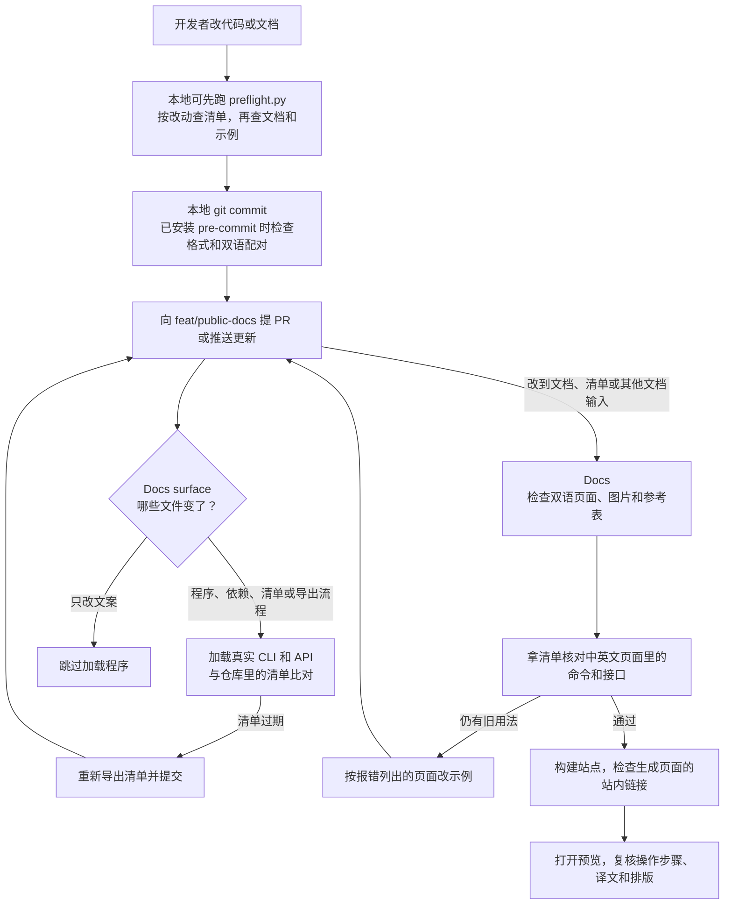

# DeepTutor 文档贡献与检查流程

## 从改代码到审文档

两条工作流独立触发。只改 CLI 时，`Docs surface` 能发现清单过期。重新导出的清单位于 `docs/tests/docs_surface.json`，提交它会触发 `Docs`。只改教程文案时，直接走文档检查和预览。

## 每一步用什么工具

| 环节 | 工具 | 能发现什么，谁来处理 |
| --- | --- | --- |
| 1. 提交前查格式和双语配对 | `pre-commit` 调用 `markdownlint-cli2` 和 `python3 docs/scripts/check_docs.py staged-parity` | 检查 Markdown 写法，并从 Git 暂存区核对中英文页面路径。例如中文页已写好却忘了 `git add`，作者在提交前就会收到提示。双语配对查的是文件，译文是否准确留给人审。 |
| 2. 决定是否加载程序 | GitHub Actions、`dorny/paths-filter` v4.0.3 | 比对 PR 改动路径。CLI、后端、运行依赖、导出脚本、清单或这份工作流有变动时，启动下一步。纯文案 PR 跳过运行时依赖安装。 |
| 3. 核对真实程序和清单 | `python scripts/export_docs_surface.py --check`，读取 Typer 命令树、FastAPI 的 OpenAPI 路径和 WebSocket 路由 | 比较程序实际提供的命令、接口路径及项目版本与已提交的 JSON。清单过期时，作者运行 `python scripts/export_docs_surface.py`，把更新后的清单随代码提交。 |
| 4. 检查文档源文件 | `python3 docs/scripts/check_docs.py` | 查中英文路径、页面类型、截图校验值、GIF 引用、渠道配置字段和自动生成的参考表。能力表或 HTTP 路由索引过期时，可运行 `python3 docs/scripts/generate_reference.py` 重新生成。 |
| 5. 核对页面里的示例 | `pytest -q docs/tests` | 扫描两种语言的页面和代码示例，拿识别到的命令、HTTP 和 WebSocket 路径与清单核对；也查安装示例的版本号和页面描述。命令已改名时，报错列出仍在使用旧名字的页面。 |
| 6. 构建站点并查链接 | `npm ci`、`npm run build`（Astro / Starlight）、`python3 docs/scripts/check_docs.py links` | 生成静态页面，再检查构建产物中的站内路径是否可达。链接检查目前用仓库脚本，覆盖页面和资源路径。 |
| 7. 看预览、决定是否合并 | GitHub Pages、GitHub Actions 的预览评论、人工审阅 | 同仓 PR 有独立的整站预览。外部 fork 可以在自己的 Pages 开分支预览。维护者从中英文入口检查步骤、术语和页面效果，再结合 CI 结果决定是否合并。 |

## 贡献者在本地怎么少跑一轮 CI

从仓库根目录运行 `python docs/scripts/preflight.py`。它会检查文档源文件和中英文页面里的示例，并根据工作区改动决定是否加载真实 CLI/API。默认运行只校验清单。源码与文档可以在同一个提交里修好。

| 场景 | 本地操作 |
| --- | --- |
| 只改文案 | 在当前 Python 环境安装 `pytest` 和 `pytest-asyncio`，运行 `python docs/scripts/preflight.py`。命令、接口等输入没有改动时会跳过实时导出。 |
| 命令或接口改名 | 使用装有 `requirements/full.txt` 和 `requirements/partners.txt` 的项目环境，运行 `python docs/scripts/preflight.py --update-surface`。脚本写入新清单，再检查页面。照报错更新旧示例，重跑检查，将代码、清单和页面一起提交。 |
| 改动已在本地提交 | 加 `--base upstream/feat/public-docs`，把 `upstream` 换成实际目标远端。默认比较当前工作区与 HEAD，包含未跟踪的相关文件。指定目标分支后，也会检查从共同祖先到当前工作区的变化。 |
| 改了路径、导航或想确认构建效果 | 使用 Node.js 22，首次或锁文件变动后在 `docs/` 执行 `npm ci`。从仓库根目录运行 `python docs/scripts/preflight.py --build`。源码和示例通过后才构建网站，随后检查新产物的站内路径。可与其他选项组合。 |
| 改了模块清单或路由索引 | 如检查提示参考表过期，运行 `python docs/scripts/generate_reference.py`，再重跑本地检查。参考表和 CLI/API 的 JSON 清单各有自己的生成器。 |

本地入口和 CI 共用 `.github/docs-surface-paths.json` 来决定是否核对真实程序。页面测试仍然扫描整个文档站，所以即使教程本身没有修改，也能查出里面的命令已过期。运行 `pre-commit install` 安装钩子后，提交时还会单独检查暂存文件的 Markdown 格式和双语路径。

CI 在构建前查一次文档源文件，在普通构建和预览构建后分别用 `check_docs.py links` 查各自产物。单独复核已经构建好的站点时，原来的 `check_docs.py dist` 仍同时检查源码和链接。
